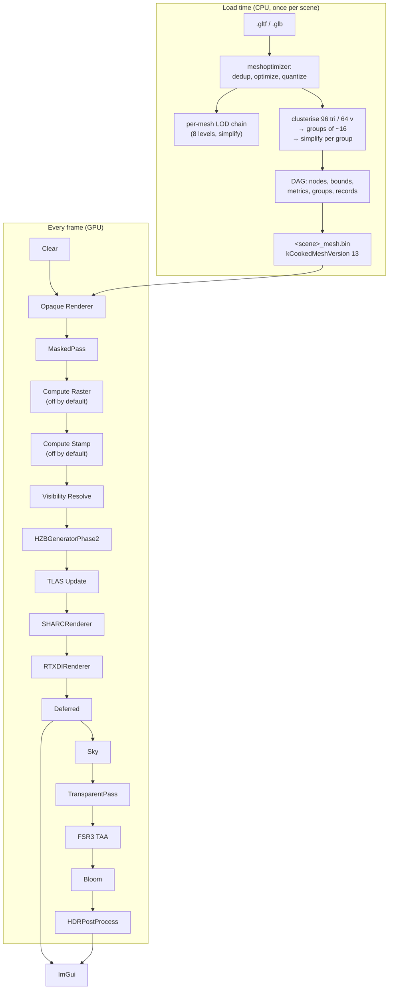
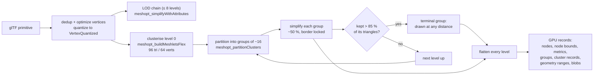
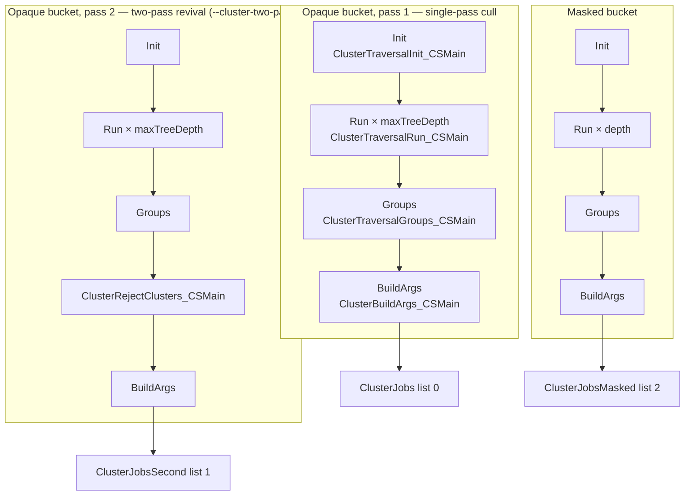
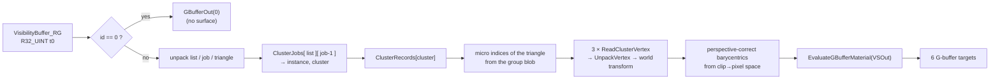
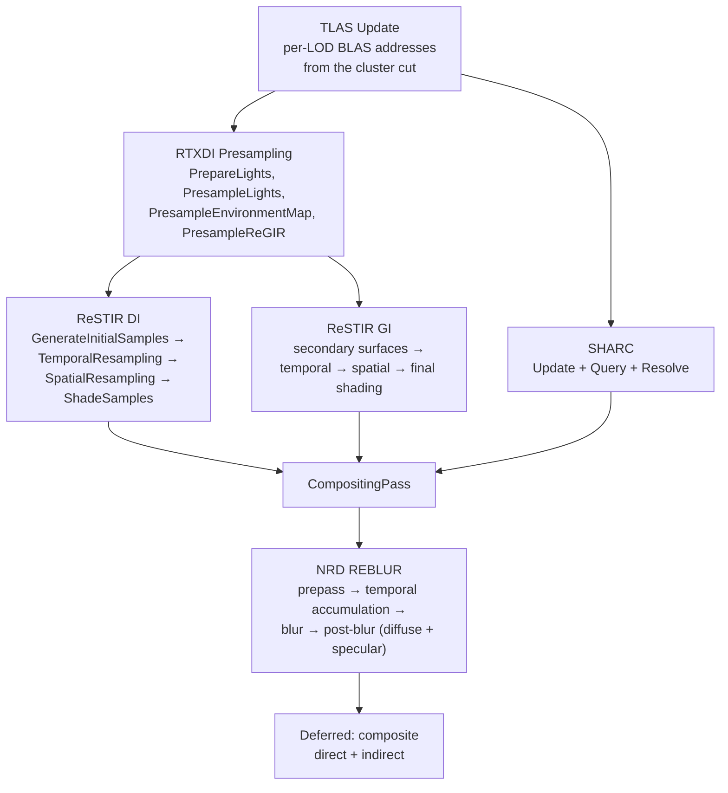

# Geometry → Lighting: the whole pipeline, end to end

This document follows one triangle from a glTF file to a lit pixel. It names every pass, shader
entry point, buffer and texture on the way, in the order the frame executes them.

**The pipeline has exactly one geometry path.** Cluster LOD (a DAG of cluster groups built at load
time) plus the visibility buffer (one packed 32-bit id per pixel, resolved into the G-buffer by a
compute pass). There is no vertex-shader G-buffer path, no meshlet path and no runtime switch
between them — the old ones were deleted, so any surface on screen got there through the passes
below. The only exception is the transparent bucket, which is still a forward vertex-shader pass
(blending needs back-to-front order, which a per-cluster list cannot give).

---

## 0. The frame in one picture



Pass order is fixed in `Renderer::ScheduleAndRunAllRenderers()` (`src/Renderer.cpp`). Each pass is
an `IRenderer` registered in `RendererRegistry`; the graph runs `Setup()` to declare its reads and
writes, then `Render()` to record. Recording happens concurrently on the task pool, submission is
serial.

| # | Registry key | `GetName()` | Type | Writes |
|---|---|---|---|---|
| 1 | `ClearRenderer` | `Clear` | compute | `VisibilityBuffer_RG`, G-buffer clears, HZB clear |
| 2 | `OpaqueRenderer` | `Opaque Renderer` | compute + mesh | depth, stencil, `VisibilityBuffer_RG`, cluster lists |
| 3 | `ClusterRevivalRenderer` | `Cluster Revival` | compute + mesh | depth, `VisibilityBuffer_RG`, cluster list 1 (only with `--cluster-two-pass`) |
| 4 | `MaskedPassRenderer` | `MaskedPass` | compute + mesh | depth, stencil, `VisibilityBuffer_RG`, masked cluster list |
| 5 | `ComputeRasterRenderer` | `Compute Raster` | compute | `ClusterComputeRaster` stamps (off by default) |
| 6 | `ComputeStampRenderer` | `Compute Stamp` | graphics | depth/stencil, `VisibilityBuffer_RG` (off by default) |
| 7 | `VisibilityResolveRenderer` | `Visibility Resolve` | compute | all six `GBuffer*_RG` targets |
| 8 | `HZBGeneratorPhase2` | `HZBGeneratorPhase2` | compute | `HZBTexture_RG` mip 1+ |
| 9 | `TLASRenderer` | `TLAS Update` | compute | TLAS instance BLAS addresses |
| 10 | `SHARCRenderer` | `SHARCRenderer` | compute | SHARC hash cache, `SHARCIndirect` |
| 11 | `RTXDIRenderer` | `RTXDIRenderer` | compute | `RTXDIComposited`, NRD history |
| 12 | `DeferredRenderer` | `Deferred` | fullscreen | `HDRColor_RG` |
| 13 | `SkyRenderer` | `Sky` | fullscreen | `HDRColor_RG` |
| 14 | `TransparentPassRenderer` | `TransparentPass` | graphics | `HDRColor_RG`, `OpaqueColor_RG`, depth |
| 15 | `TAARenderer` | `FSR3 TAA` | compute | TAA history + `HDRColor_RG` |
| 16 | `BloomRenderer` | `Bloom` | fullscreen | bloom pyramid, `HDRColor_RG` |
| 17 | `HDRPostProcess` | `HDRPostProcess` | fullscreen | swapchain |

`--debug <n>` takes a different, shorter schedule (`Renderer::ScheduleDebugView()`): Clear → Opaque
→ Masked → Compute Raster → Compute Stamp → Visibility Resolve → HZB → TLAS → RTXDI → Deferred →
HDR. The resolve **must** be in that list, or every view read off the G-buffer is black.

---

## 1. Load time: where the geometry comes from

`SceneLoader::ProcessMeshesFromGLTF` → `SceneLoader::ProcessMeshes` → `ClusterLod::BuildClusters`
(`src/ClusterLodBuilder.cpp`), cached by `SceneCache` into `<scene>_mesh.bin`.



Why it is a DAG and not a chain: a coarser group can take clusters from several finer groups
(`docs/cluster-lod-implementation-plan.md`). A group that cannot be simplified further keeps no
replacement, so its clusters are drawn at any distance — that is what makes the cut watertight.

### Records (also the on-disk cooked layout)

`src/shaders/Cluster.sr`. The first four are written byte-for-byte into the cache, so changing a
field means bumping `SceneCache::kCookedMeshVersion`.

| Struct | Size | Written by | Read by |
|---|---|---|---|
| `ClusterNode` | 4 B | cook | traversal (`Init`/`Run`) |
| `ClusterBounds` | 32 B | cook | traversal (cone/backface reject) |
| `ClusterTraversalMetric` | 20 B | cook | traversal (the cut) |
| `ClusterGroup` | 64 B | cook | traversal (`Groups`) |
| `ClusterGeometry` | 40 B | `BuildGpuData` | traversal (per-primitive ranges) |
| `ClusterRecord` | 32 B | `BuildGpuData` | mesh shader, resolve |
| `ClusterJob` | 8 B | traversal | mesh shader, resolve, compute raster |
| `ClusterNodeRef` / `ClusterGroupRef` | 12 B | traversal | traversal only |
| `ClusterCounters` | 52 B | traversal | CPU readback (`--cluster-stats-frame`) |

`ClusterNode::m_Packed` — bit 0 is the leaf flag:

```
interior:  [ childOffset : 26 ][ childCount-1 : 5 ][ leaf : 1 ]
leaf:      [ groupIndex  : 23 ][ groupCount-1 : 8 ][ leaf : 1 ]
```

`ClusterRecord` is the draw-side view of one cluster: `m_TriangleCount`, `m_VertexCount`,
`m_LODLevel`, `m_GroupIndex`, `m_TriangleOffset` and `m_AttributeOffset` (both **into the group's
blob**), and `m_CenterRadius[2]` (halves: x,y then z,radius).

### Scene-owned GPU buffers (`src/Scene.h`)

| Buffer | Contents |
|---|---|
| `m_ClusterNodeBuffer` | `ClusterNode` flat array |
| `m_ClusterNodeBoundsBuffer` | `ClusterBounds` |
| `m_ClusterGroupBuffer` | `ClusterGroup` |
| `m_ClusterGeneratingGroupsBuffer` | group index → the groups it replaced (the cut's upward edge) |
| `m_ClusterGeometryBuffer` | `ClusterGeometry`, per `MeshData` |
| `m_ClusterLevelMeshLODBuffer` | cluster level → matching per-mesh LOD (ray tracing) |
| `m_ClusterRecordBuffer` | `ClusterRecord` |
| `GeometryStreaming::m_StreamData` | the arena, one `uint` per element (triangle words, then six `VertexQuantized` words per vertex) |
| `GeometryStreaming::m_GroupStates` | `ClusterGroupState` per global group: the arena address, or 0 = not resident |
| `GeometryStreaming::m_LoadRequests` / `m_StreamCounters` | streaming requests and counters |
| `GeometryStreaming::m_DiscreteLevels` | per-instance discrete-LOD seed (list `g_DiscreteLODLevels`) |
| `m_InstanceDataBuffer` | `PerInstanceData` (world, prev world, material index, mesh-data index, sphere) |
| `m_VertexBufferQuantized`, `m_IndexBuffer`, `m_MeshDataBuffer` | raster LOD fallback + ray tracing |
| `m_MaterialConstantsBuffer`, `m_LightBuffer` | materials, lights |
| `m_TLAS` | top-level acceleration structure |

---

## 2. The cut: building the visible-cluster list

The traversal runs inside the base pass, once per bucket, before the draw. It is four compute
dispatches (`src/shaders/ClusterTraversal.hlsl`, driven by `BasePassRenderer::PerformClusterTraversal`):



| Dispatch | Shader entry | Threads | Job |
|---|---|---|---|
| Init | `CLUSTERTRAVERSAL_CLUSTERTRAVERSALINIT_CSMAIN` | one per instance | instance sphere test (frustum, HZB, cone), LOD classify, seed the node queue with the primitive's root |
| Run | `CLUSTERTRAVERSAL_CLUSTERTRAVERSALRUN_CSMAIN` | one per queued node | interior node: test children bounds, queue survivors; leaf: queue its group |
| Groups | `CLUSTERTRAVERSAL_CLUSTERTRAVERSALGROUPS_CSMAIN` | one per queued group | the cut rule, then per-cluster HZB sphere test, then append the group's clusters to the visible-cluster list |
| Build args | `CLUSTERTRAVERSAL_CLUSTERBUILDARGS_CSMAIN` | 1 | writes the dispatch grid into `m_ClusterIndirectBuffer` |
| Reject clusters | `CLUSTERTRAVERSAL_CLUSTERREJECTCLUSTERS_CSMAIN` | — | two-pass only: recover what occlusion alone rejected |

The cut rule is `ClusterLod::EvaluateCut`, and the shader is the same rule: draw a group when it is
detailed enough for this camera **and** the group that replaced it is not. The threshold is
`--cluster-error` in pixels (default 1.0), which makes the cut follow the projection instead of a
per-mesh heuristic.

**Queues and budgets.** `Scene::kClusterBucketOpaque` / `kClusterBucketMasked` each own their
traversal buffers, sized from that bucket's own worst case:

| Budget | Default | Overflow behaviour |
|---|---|---|
| `kMaxClusterJobs` | 4 M | append dropped, counted in `ClusterCounters::m_ClusterCapped` |
| `kMaxClusterNodeRefs` | 2 M | ref dropped, counted |
| `kMaxClusterGroupRefs` | 2 M | ref dropped, counted |

A cap costs image coverage, never a buffer overrun. `ClusterCounters` is read back through
`Renderer::LogClusterCounters()` and shown in the panel.

Two invariants of the two-pass path are easy to break and both have been:

* The reject bitmask is indexed by a cluster's **global record index** (the index it reads
  `m_ClusterRecordBuffer` with), not by its slot in a bucket's job list. A bucket only owns the records of
  its own primitives, and those sit anywhere in that array, so the mask must be sized by the scene-wide
  record count (`Scene::m_ClusterRecordCount`), never by `m_MaxClusterJobCount[bucket]`.
* The second pass dispatches its seeds and its per-cluster re-test from the grids `ClusterBuildArgs` wrote
  into `m_ClusterIndirectBuffer`, so the base pass **reads** that buffer as well as writing it and declares
  both. `--rendergraph-strict-access` reports the missing read.
* The revival is a **pass of its own** (`Cluster Revival`, scheduled straight after `Opaque Renderer`),
  not the tail of the opaque pass. `GenerateHZBMips` in the opaque pass reads the depth buffer and the
  revived draw writes it; a pass holds one state per resource, so an intra-pass read-to-write left the draw
  depth-testing against a texture still in a shader-resource state (`rdc-tools hazards` reported
  `DepthBuffer_RG` read as DSV, and only with two-pass on). Split out, the graph orders the two accesses and
  the revival declares the depth as a write and the HZB as a read.
* What two-pass changes, measured: the **rasterised** image is the single-pass one (animals, same pose,
  `--no-rt-shadows --no-restir-di`: 1 pixel of 2,073,600 differs, which is the run-to-run noise floor),
  while a handful of ray-traced pixels move (~130) because the second pass re-writes
  `InstanceLODBuffer` and `TLASPatch` consumes it. The cluster-ids view does differ, by design: a revived
  cluster that covers pixels an already-drawn cluster also covers resolves to a different record.

**Discrete LOD.** An instance whose cut resolves to a single level is seeded *at* that level with
`ClusterRefFlags::kDiscrete`, and its groups pass skips the metric test — the traversal costs
nothing there, and ray tracing gets one level to match (`m_ClusterLevelMeshLODBuffer`).

### The four id lists

The resolve must decode an id against **the same list the raster wrote it from**, so each bucket
publishes its list through `g_RG_VisClusterJobLists[]` (`src/BasePassCommon.h`):

| Index | Published by | Contents |
|---|---|---|
| 0 | `OpaqueRenderer` | pass 1 visible clusters |
| 1 | `OpaqueRenderer` | pass 2 (two-pass revival) clusters |
| 2 | `MaskedPassRenderer` | masked bucket clusters |
| 3 | `OpaqueRenderer` | clusters routed to the compute software raster |

`g_RG_ClusterIndirectArgs` is published alongside them: its slot `kClusterIndirectSlotComputeRaster`
(= 4) holds the routed-cluster count, which is exactly the compute pass' dispatch grid.

---

## 3. Rasterising ids: the visibility pass

`BasePassRenderer::RenderInstances` (`src/BasePassRenderer.cpp`) draws the opaque and masked
buckets with a **mesh pipeline**:

| Stage | Shader | What it does |
|---|---|---|
| AS | `ClusterVis.hlsl` → `CLUSTERVIS_ASMAIN` | one workgroup per job; publishes `ClusterVisPayload{instance, cluster, jobIndex}` |
| MS | `ClusterVis.hlsl` → `CLUSTERVIS_MSMAIN` | `SetMeshOutputCounts(cluster.vertexCount, cluster.triangleCount)`; expands the cluster from its blob; emits `VisVertexOut{position, uv}` and `VisPrimitiveOut{jobIndex, triangleIndex}` |
| PS | `CLUSTERVIS_PSMAIN` | `return PackVisId(jobIndex, triangleIndex);` — one `uint` store |
| PS (masked) | `CLUSTERVIS_PSMAINALPHATEST_ALPHATEST_ALPHA_TEST_1` | samples albedo through the streamed sampler, `discard`s below `m_AlphaCutoff`, then writes the id |

Two details that matter:

* A mesh pipeline gives its pixel shader **no** `SV_PrimitiveID`, so the triangle index can only
  arrive through the mesh shader's `out primitives` block. That is why `VisPrimitiveOut` exists and
  why its semantics (`SV_PrimitiveID`, `TEXCOORD1`) must not collide with the vertex output's.
* The **alpha test runs in the raster**, not in the resolve. Deferring it would leave nothing
  behind the discarded texels to shade — a hole. The uv is the rasteriser's own interpolant and the
  sample goes through the same streamed sampler, so the decision matches a G-buffer raster texel for
  texel (and it writes the sampler-feedback the streaming needs).

The framebuffer is one `R32_UINT` attachment plus the shared `D24S8` depth. Depth and stencil state
is unchanged from the deleted raster path — depth write, stencil `Replace` with ref 1 — so the HZB
and the deferred pass' stencil test still describe the same surfaces.

### The id, bit by bit

`PackVisId` / the unpack in the resolve live in `src/shaders/BasePassCommon.hlsli`:

```
 31                30        29                                    7        6              0
 +-----------------+---------+-------------------------------------+--------+----------------+
 |  list (2 bits)  |         |            jobIndex + 1             |        |  triangleIndex |
 +-----------------+---------+-------------------------------------+--------+----------------+
      0 = opaque pass 1, 1 = two-pass list, 2 = masked        1-based; 0 = no visible job   0..127
```

`0` as a whole word means **no surface**, which is what the clear leaves behind, so an empty pixel
costs the resolve nothing. 23 bits of job and 7 bits of triangle are also why a cluster is capped at
128 triangles.

`g_PerFrame.m_VisListIndex` (in `BasePassConstants`, `src/shaders/BasePass.sr`) selects which list a
given draw packs into.

### `BasePassInputs` — the binding set the raster, the resolve and the compute raster share

Declared once in `src/shaders/BasePass.sr`, generated into C++ by srrhi, so the raster's mesh state and
the resolve's binding set are literally the same layout:

| Slot | Resource |
|---|---|
| `b0` | `BasePassConstants` (`m_PerFrameCB`: view matrices, frustum planes, culling flags, `m_DebugMode`, `m_VisListIndex`, `m_Width`/`m_Height`) |
| `t0`–`t2` | `Instances`, `Materials`, `Vertices` (`VertexQuantized`) |
| `t3` | `MeshData` |
| `t4`–`t7` | unused (left vacant by the deleted meshlet arrays; kept out of range so the live slots below do not move) |
| `t8`–`t12` | `HZB`, `SceneAS`, `Indices`, `OpaqueColor`, `Lights` |
| `t13`–`t17` | `ClusterJobs`, `ClusterRecords`, `ClusterStreamData`, `ClusterGroups`, `ClusterGroupStates` |
| `t19` | `ClusterJobsSecond` (vis id list 1) |
| `t20` | `ClusterJobsMasked` (vis id list 2) |

### The compute software raster (built, measured, off)

`--compute-raster 1` (default 0) routes clusters whose projected half-extent is at most
`--compute-raster-pixels` (default 2 px) into list 3 instead of the mesh dispatch:

| Pass | Shader | Work |
|---|---|---|
| `Compute Raster` | `ClusterComputeRaster.hlsl` → `CLUSTERCOMPUTERASTER_CSMAIN` | finds the samples each sub-pixel triangle covers, appends `(x, y, asuint(ndcZ), id)` stamps |
| `Compute Stamp` | `StampRaster.hlsl` → `STAMPRASTER_VSMAIN` / `STAMPRASTER_PSMAIN` | replays the stamps as one-pixel points through the hardware depth test and stencil replace |

It cannot write depth from compute because `D24S8` is not a UAV and carries the barrel stencil mask,
which is why the coverage stamp + point replay indirection exists. It is correct (animals, 8 px:
78 % of clusters routed, 1 pixel of 2,073,600 differs) but it *loses* — +5.7 % GPU time at 2 px and
+15 % at 8 px — because the id pass it replaces has almost no shading to waste. See the comment in
`Config::m_bComputeRaster` before turning it on.

---

## 4. Geometry streaming (optional)

When the arena budget (`--stream-budget`) cannot hold every group, a group's triangle and vertex
words live in `ClusterStreamBuffer` and the group record carries an address into it.

| Shader | Purpose |
|---|---|
| `ClusterStreaming.hlsl` → `CLUSTERSTREAMUPDATE_CSMAIN` | serves the load requests the traversal filed, copying groups from the cache into arena slots |
| `ClusterStreaming.hlsl` → `CLUSTERSTREAMAGEFILTER_CSMAIN` | ages unfetched groups out when the budget forced a trim |

The traversal reads `ClusterGroupState` for a group's address; a group whose address is not valid is
*requested* and, in the same frame, drawn from its nearest resident coarser group — so a level
streams in without a hole. `ClusterStreamCounters` feeds the streaming panel.

---

## 5. The resolve: id → G-buffer

`src/VisibilityResolveRenderer.cpp` / `src/shaders/VisibilityResolve.hlsl`, one invocation per pixel.



It rebuilds, geometrically, the interpolant the raster *would* have handed its pixel shader: same
per-vertex transform, same tangent frame, same two matrix multiplications in the same order,
interpolated with screen-space perspective-correct barycentrics. Material evaluation is then the
same code the raster path used — `EvaluateGBufferMaterial` in `src/shaders/GBufferMaterial.hlsli`,
one definition, so the two can never drift apart.

The resolve binds the **base pass' binding set** (instances, materials, vertices, mesh data,
cluster stream data, group states, indices, lights) plus its own set for the id buffer:

| Slot | Resource |
|---|---|
| `t0`, space 1 | `VisibilityBuffer` (`Texture2D<uint>`) |
| `t1`, space 1 | `ClusterJobsCompute` (list 3) |

Depth is **not** written here, and must not be: the raster still owns it, which is what keeps the
HZB and the occlusion decisions identical to what the cut assumed.

### G-buffer targets

| Target | Format | Contents |
|---|---|---|
| `GBufferAlbedo_RG` | `RGBA8_UNORM` | base colour × texture, alpha |
| `GBufferNormals_RG` | `RG16_FLOAT` | oct-encoded world normal (with normal map) |
| `GBufferGeoNormals_RG` | `RG16_FLOAT` | oct-encoded geometric normal |
| `GBufferORM_RG` | `RG8_UNORM` | occlusion / roughness, metallic |
| `GBufferEmissive_RG` | `RGBA16_FLOAT` | emissive |
| `GBufferMotion_RG` | `RGBA16_FLOAT` | current and previous clip position |

Textures are sampled with an **analytic** LOD: the resolve has no triangle to differentiate, so
`VisibilityResolve.hlsl` derives ddx/ddy from the reconstructed position and clamps up to the
resident min-mip, then `SampleLevel`s. That keeps sampler feedback coherent with the streaming
system, at the cost of a wider resident tile set (the known VRAM backlog item).

---

## 6. Lighting

### 6.1 Deferred: the direct sun and the sky

`DeferredRenderer` → `DEFERREDLIGHTING_DEFERREDLIGHTING_PSMAIN`, one fullscreen pass over the
surfaces the stencil marks (`stencilFunc == Equal`, ref 1), depth read-only.

| Input | Source |
|---|---|
| `GBufferAlbedo/Normals/ORM/Emissive/Motion` | written by the resolve |
| `Depth` | written by the raster |
| `SceneAS` | `Scene::m_TLAS` |
| `Lights` | `Scene::m_LightBuffer` |
| `Instances`, `Materials`, `Vertices`, `MeshData`, `Indices` | for inline ray queries (`GetTriangleVertices`) |
| `RTXDIDIComposited` | ReSTIR DI output |
| `SHARCIndirect` | SHARC output |

The pixel shader lights the surface with the sun (an **inline ray query** against `SceneAS`, not a
shadow map), evaluates the material's BRDF, and adds the selected indirect technique. It writes
`HDRColor_RG` (`R11G11B10_FLOAT`).

Debug views short-circuit here: instances, clusters, cluster LOD and triangles pass their G-buffer
colour through unlit so the view is readable rather than lit.

### 6.2 The lighting stack, pass by pass



| Technique | Shaders (prefix `RTXDI_` / `SHARC` / `REBLUR`) | Notes |
|---|---|---|
| Sun shadows | inline `RayQuery` in the deferred pass | `--no-rt-shadows` falls back to the deferred pass' own single ray |
| OMM | baked at load (`OmmSceneBaker`), linked into the BLAS | alpha-masked rays resolve opacity in hardware |
| ReSTIR DI | `LIGHTINGPASSES_DI_GENERATEINITIALSAMPLES_MAIN` → `DI_TEMPORALRESAMPLING_MAIN` → `DI_SPATIALRESAMPLING_MAIN` → `DI_SHADESAMPLES_MAIN` | 8/8/8 samples on the Balanced preset |
| ReGIR | `PRESAMPLING_PRESAMPLEREGIR_MAIN` (`RTXDI_REGIR_ONION` / `GRID`) | Onion: 5 detail + 10 coverage layers |
| ReSTIR GI | `LIGHTINGPASSES_SHADESECONDARYSURFACES_MAIN` → `GI_TEMPORALRESAMPLING_MAIN` → `GI_SPATIALRESAMPLING_MAIN` → `GI_FINALSHADING_MAIN` | |
| SHARC | `SHARCUPDATE_CSMAIN`, `SHARCQUERY_CSMAIN`, `SHARCRESOLVE_CSMAIN` | screen-space hash radiance cache |
| Denoise | `REBLUR_PREPASS`, `REBLUR_TEMPORALACCUMULATION`, `REBLUR_BLUR`, `REBLUR_POSTBLUR`, `REBLUR_HITDISTRECONSTRUCTION` | diffuse and specular signals |
| Checkerboard | half-pixel traces + NRD reconstruction | on for Balanced / High performance |

Ray tracing consumes the *same* geometry the raster drew: the cluster traversal owns the per-instance
LOD, writes it to `m_InstanceLODBuffer`, and `TLASPATCH_TLASPATCH_CSMAIN` patches each instance's BLAS
address to that level before the rays run. That is what stops the raster and the rays from disagreeing
about which LOD a surface is.

### 6.3 Sky and transparent

* `SkyRenderer` → `SKY_SKY_PSMAIN`: a Bruneton precomputed atmosphere drives both the sky colour and
  the sun direction/colour used by everything above.
* `TransparentPassRenderer`: the one remaining forward **vertex-shader** pass
  (`BASEPASS_VSMAIN` + `BASEPASS_FORWARD_PSMAIN_FORWARD_TRANSPARENT_FORWARD_TRANSPARENT_1`), drawing
  `drawIndexedIndirect` over the instance-culled `visibleIndirect` list, with transmission, spectral
  attenuation and volumetric absorption. It reads the opaques' depth so blended surfaces sort against
  them, and writes `HDRColor_RG`.

---

## 7. Post-processing

| Pass | Shaders | Effect |
|---|---|---|
| `FSR3 TAA` | FidelityFX TAA | jitter-cancelled temporal AA, HDR-aware, exposure-aware pre-exposure |
| `Bloom` | `BLOOM_PREFILTER_PSMAIN` → `BLOOM_DOWNSAMPLE_PSMAIN` → `BLOOM_UPSAMPLE_PSMAIN` → `BLOOM_COMPOSITE_PSMAIN` | only what is above SDR white blooms |
| `HDRPostProcess` | `LUMINANCEHISTOGRAM_CSMAIN` → `EXPOSUREADAPTATION_CSMAIN` (+ `FULLSCREEN_MSMAIN`) | histogram, EV100 auto-exposure, PBR Neutral tone map, sRGB or scRGB |

---

## 8. Resource reference

### Render-graph textures (`src/Renderer.h`)

| Handle | Debug name | Format | Written by | Read by |
|---|---|---|---|---|
| `g_RG_DepthTexture` | `DepthBuffer_RG` | `D24S8` | Opaque, Masked, Transparent | HZB, Deferred, Sky, TAA |
| `g_RG_VisibilityBuffer` | `VisibilityBuffer_RG` | `R32_UINT` | Clear (0), Opaque, Masked, Compute Stamp | Visibility Resolve |
| `g_RG_GBufferAlbedo` | `GBufferAlbedo_RG` | `RGBA8_UNORM` | Visibility Resolve | Deferred, TAA |
| `g_RG_GBufferNormals` | `GBufferNormals_RG` | `RG16_FLOAT` | Visibility Resolve | Deferred, NRD pack, TAA |
| `g_RG_GBufferGeoNormals` | `GBufferGeoNormals_RG` | `RG16_FLOAT` | Visibility Resolve | Deferred |
| `g_RG_GBufferORM` | `GBufferORM_RG` | `RG8_UNORM` | Visibility Resolve | Deferred |
| `g_RG_GBufferEmissive` | `GBufferEmissive_RG` | `RGBA16_FLOAT` | Visibility Resolve | Deferred, Bloom |
| `g_RG_GBufferMotionVectors` | `GBufferMotion_RG` | `RGBA16_FLOAT` | Visibility Resolve | TAA, NRD |
| `g_RG_HZBTexture` | `HZB` | `R32_FLOAT` chain | Opaque (SPD), HZBGeneratorPhase2 | traversal, Opaque pass 2 |
| `g_RG_HDRColor` | `HDRColor_RG` | `R11G11B10_FLOAT` | Deferred, Sky, Transparent, TAA, Bloom | TAA, Bloom, HDRPostProcess |
| `g_RG_OpaqueColor` | `OpaqueColorTexture_RG` | `R11G11B10_FLOAT` + mips | Transparent | transmission |

The id target carries the **UAV flag** even though it is only rendered to: `clearTextureUInt` takes
the UAV path for a UAV texture, and the render-target path would send float values to an integer
format, which D3D12 rejects.

### Pass-local cluster buffers (`BasePassResources`, `src/BasePassCommon.h`)

| Field | Purpose |
|---|---|
| `m_ClusterNodeQueue[2]` + `m_ClusterNodeQueueCount[2]` | node queue, ping-ponged per depth |
| `m_ClusterGroupQueue` + count | groups queued by the node passes |
| `m_ClusterJobs`, `m_ClusterJobCount` | the visible-cluster list (published as a vis id list) |
| `m_ClusterJobsCompute`, `m_ClusterJobCountCompute` | list 3 for the software raster |
| `m_ClusterIndirectBuffer` | `DispatchIndirectArguments`; slot 0 = mesh grid, slot `kClusterIndirectSlotComputeRaster` = compute grid |
| `m_ClusterCountersBuffer` | `ClusterCounters` |
| `m_ClusterRejectNodes/…GroupCount`, `m_ClusterRejectMasks`, `m_ClusterJobsSecond` | two-pass culling |
| `m_VisibleIndirectBuffer`, `m_VisibleCountBuffer` | instance-culled draws for the transparent pass |
| `m_OccludedIndices/Count/Indirect` | phase-2 occlusion culling |
| `m_PipelineQueries[2]` | per-bucket pipeline statistics |

---

## 9. Debug views and validation

| `--debug <n>` | View | Produced by |
|---|---|---|
| 1 | Instances | resolve (hash of instance id) |
| 2 | World normals | deferred |
| 3 | Albedo | deferred (passthrough) |
| 4–6 | Roughness, metallic, emissive | deferred |
| 7 | LOD | resolve |
| 8 | Motion vectors | deferred |
| 9 | ReGIR cells | RTXDI |
| 10 | Streaming mip | base pass → resolve → deferred |
| 11 | Cluster ids | resolve (hash of cluster index) |
| 12 | Cluster LOD level | resolve (32-level ramp) |
| 13 | Triangles | resolve (hash of triangle index) |

`--cluster-debug 1|2` maps to modes 11/12, `--cluster-debug 4` is the traversal-counters panel.

Validation switches used throughout development: `--rhidebug` (D3D12 debug layer),
`--rhidebug-gpu` (GPU-based validation), `--rendergraph-strict-access` (the graph asserts every
resource a pass binds was declared). `--rendergraph-dump-frame <n>` writes the graph itself as
Markdown.

---

## 10. File map

| Path | Role |
|---|---|
| `src/ClusterLod.{h,cpp}` | cook-time DAG types, `EvaluateCut`, config hash |
| `src/ClusterLodBuilder.cpp` | clusterise → partition → simplify → emit |
| `src/ClusterLodGpu.cpp` | `BuildGpuData` (records, geometry ranges, blobs) |
| `src/ClusterLodScene.cpp` | `--cluster-stats` checks against the CPU reference |
| `src/SceneLoader.cpp` | glTF → vertices/indices → cook → GPU buffers |
| `src/SceneCache.{h,cpp}` | versioned cooked-mesh file (`kCookedMeshVersion`) |
| `src/BasePassRenderer.cpp` | the buckets, the traversal dispatch, the mesh draw |
| `src/BasePassCommon.{h,cpp}` | shared base-pass resources + the published vis id lists |
| `src/VisibilityResolveRenderer.cpp` | the resolve pass |
| `src/ComputeRasterRenderer.cpp` | compute raster + stamp replay (off by default) |
| `src/DeferredRenderer.cpp` | deferred lighting |
| `src/RTXDIRenderer.cpp`, `src/SHARCRenderer.cpp` | ReSTIR DI/GI + ReGIR, SHARC, NRD |
| `src/shaders/Cluster.sr` | the records above (also the cooked layout) |
| `src/shaders/ClusterTraversal.hlsl` | the four cut dispatches |
| `src/shaders/ClusterVis.hlsl` | AS/MS/PS that writes ids |
| `src/shaders/VisibilityResolve.{sr,hlsl}` | the decode + rebuild + material evaluation |
| `src/shaders/GBufferMaterial.hlsli` | the single material evaluation both paths used |
| `src/shaders/BasePassCommon.hlsli` | `PackVisId`, cluster stream decode, `VSOut` |
| `src/shaders/ClusterStreaming.hlsl` | arena update + age filter |
| `src/shaders/DeferredLighting.hlsl` | the lit G-buffer read |

Deeper background: `docs/cluster-lod-implementation-plan.md`,
`docs/visibility_buffer_implementation_plan.md`, `docs/visibility_buffer_analysis.md`,
`docs/cluster-lod-upstream-review-2026-11-23.md`, and `PIPELINE.md` for the render graph itself.
