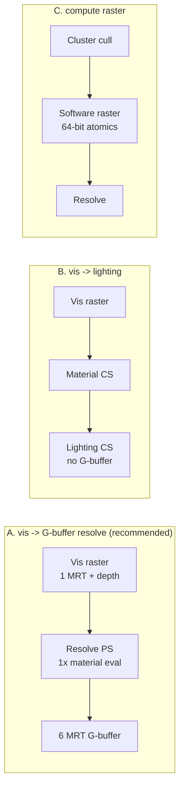
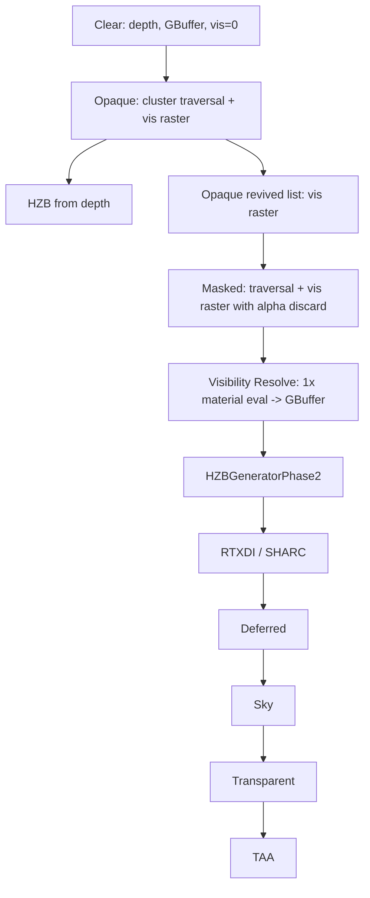

# Visibility Buffer — Research & Analysis

Status: research / design analysis only. No renderer code has been changed.

This document answers one question: **what would it take to add a visibility buffer to
HobbyRenderer on top of the existing G-buffer and Cluster LOD pipeline, and is it worth
doing?**

---

## Table of Contents

1. [Summary and recommendation](#1-summary-and-recommendation)
2. [Scope, assumptions and open questions](#2-scope-assumptions-and-open-questions)
3. [What the renderer does today (the constraints)](#3-what-the-renderer-does-today-the-constraints)
4. [Prior art](#4-prior-art)
5. [Design space](#5-design-space)
6. [Recommendation in detail](#6-recommendation-in-detail)
7. [Cost and benefit model](#7-cost-and-benefit-model)
8. [Implementation plan](#8-implementation-plan)
9. [Verification plan](#9-verification-plan)
10. [Risks and open questions](#10-risks-and-open-questions)
11. [References](#11-references)

---

## 1. Summary and recommendation

**What a visibility buffer buys, in one sentence:** rasterisation stores a 32-bit
`(draw/cluster, triangle)` id instead of evaluating the material and writing six G-buffer
targets per rasterised fragment; a full-screen resolve then evaluates the material exactly
once per pixel, with no 2×2 helper lanes wasted on triangle edges.

The reason this matters for *this* renderer is quad utilisation, not memory. Cluster LOD
already produces small triangles (Bistro's props reach 1–10 pixel triangles at the default
error threshold), and the base pass is a 6-MRT pixel shader with up to 4 streamed texture
samples. With 10-pixel triangles a deferred/forward material shader runs roughly **2×** per
pixel; with 1-pixel triangles roughly **4×**. A visibility resolve runs **1×** regardless of
triangle size.

**Recommendation: implement variant A — visibility buffer → existing G-buffer resolve.**

- Keep every downstream consumer untouched: `DeferredRenderer`, `RTXDIRenderer`,
  `SHARCRenderer`, `TAARenderer`, NRD, sky and transparent pass all keep reading the same six
  G-buffer textures with the same formats. The visibility buffer only replaces *who writes
  them* and *when*.
- Do it for the **opaque cluster bucket first**, behind `--vis-buffer <0|1>`, with the current
  path as the default until the A/B gates in §9 pass.
- Do **not** start with a compute software rasteriser or a per-material binning pipeline.
  Both are real techniques (Nanite, The-Forge 2.0) but they are the second step, and neither
  is needed to answer "is the resolve worth it?".

**Expected outcome (honest version):** the win is real for dense, small-triangle geometry and
is close to zero or slightly negative for scenes dominated by large triangles (Bistro's
buildings are level-0 large triangles; the props are not). Expect the frame to get *cheaper*
in the base pass and slightly *more expensive* in a new resolve pass; the net depends on the
scene. The reason to build it anyway is that it removes the quad-utilisation term completely,
which is the only term that gets worse as geometry density rises.

**What this document is not:** an argument to replace the G-buffer. The G-buffer stays. A
visibility renderer that stops at "lighting" (variant B) would have to re-derive normals and
roughness for RTXDI/SHARC/NRD every time they ask, and all four of those systems read the
G-buffer today.

---

## 2. Scope, assumptions and open questions

### 2.1 Scope

In scope:

- A 32-bit visibility buffer written by the cluster mesh path (`ClusterBasePass.hlsl`).
- A full-screen resolve that reconstructs the triangle, interpolates vertex attributes,
  computes analytic screen-space derivatives, evaluates the existing material logic and writes
  the six existing G-buffer targets.
- Alpha-tested ("masked") geometry handling.
- The plumbing: render-graph resources, a new `IRenderer`, `Config`/ImGui toggles, A/B gates.

Out of scope (documented as follow-ons):

- Compute/software rasterisation of geometry (Nanite-style) — §5.1 variant C, §8 phase 5.
- Per-material indirect dispatch binning — §5.5.
- MSAA / Decoupled Visibility Multisampling (Hable part 2) — the renderer has no MSAA today.
- Software VRS (Hable part 3) and visibility TAA (Hable part 4).
- Replacing the G-buffer with per-pixel attribute re-fetch for RTXDI/SHARC/NRD.
- The legacy meshlet path and the vertex-shader path (both keep rasterising the G-buffer in
  phase 1; §8 phase 4 optionally brings the meshlet path along).

### 2.2 Assumptions

1. **The G-buffer is a contract, not a convenience.** Six targets are read by four other
   systems. Changing their formats or their contents is a separate piece of work and is not
   required.
2. **The depth buffer stays.** Reconstructing depth from a packed 64-bit vis buffer is the
   Nanite arrangement; here a depth buffer already exists, is already the occlusion-culling
   source, and is already sampled by `DeferredLighting` for sky-visibility. Paying 4 bytes for
   it twice is worse than reusing it.
3. **The vis pass is still a raster pass.** The mesh shader keeps doing culling, LOD selection
   and vertex expansion; only the pixel shader changes. This is the smallest possible change
   and keeps the existing two-pass occlusion flow intact.
4. **The resolve is a full-screen pixel shader**, not a compute dispatch. It needs
   `ddx`/`ddy`, which a pixel shader gets for free, and the repo already has
   `Renderer::AddFullScreenPass`.

### 2.3 Questions for the maintainer

These change the plan materially; they are listed again in §10.

1. **Opaque-only first, or masked in the same phase?** Masked handling (alpha test inside the
   vis pass, §5.3) is not hard, but it doubles the number of job lists the resolve must bind.
   Recommendation: opaque first, masked immediately after.
2. **Should the legacy meshlet path get a vis buffer?** The cluster path is the intended
   renderer; the meshlet path exists as an A/B reference. Recommendation: no, and say so in
   the UI.
3. **Is a non-bit-identical image acceptable?** Analytic derivatives differ from hardware
   finite differences in the last bits, so texture LOD selection can differ by one level on
   some pixels. Recommendation: yes, with the gates in §9 measuring pixel counts rather than
   exact equality.
4. **Where should the resolve sit relative to `HZBGeneratorPhase2`?** Both orders are legal
   because the resolve does not touch depth. Recommendation: immediately after
   `MaskedPassRenderer` so that RTXDI (which reads the G-buffer) cannot start early.

---

## 3. What the renderer does today (the constraints)

### 3.1 The G-buffer contract

Declared in `ClearRenderer::Setup` (`src/CommonRenderers.cpp`), format constants in
`src/Renderer.h`:

| Slot | Resource | Format | Bytes/px | Written by | Read by |
|---|---|---|---|---|---|
| 0 | `g_RG_GBufferAlbedo` | `RGBA8_UNORM` | 4 | base pass | RTXDI, SHARC, Deferred, NRD chain |
| 1 | `g_RG_GBufferNormals` | `RG16_FLOAT` (oct) | 4 | base pass | RTXDI, Deferred, NRD |
| 2 | `g_RG_GBufferORM` | `RG8_UNORM` | 2 | base pass | Deferred, NRD |
| 3 | `g_RG_GBufferEmissive` | `RGBA16_FLOAT` | 8 | base pass | Deferred (composite) |
| 4 | `g_RG_GBufferMotionVectors` | `RGBA16_FLOAT` | 8 | base pass | TAA/FSR3, RTXDI resampling |
| 5 | `g_RG_GBufferGeoNormals` | `RG16_FLOAT` (oct) | 4 | base pass | RTXDI resampling + BRDF ray tracing |
| — | `g_RG_DepthTexture` | `D24S8`, reversed-Z | 4 | base pass | HZB, Deferred, RTXDI, TAA |

Total G-buffer write traffic: **30 bytes/pixel**, plus stencil bit 0 as the "surface exists"
mask (`DeferredLighting` runs with `stencilFunc = Equal, ref = 1`).

Behaviour that must be reproduced exactly, because other systems depend on it:

- Albedo alpha carries the material alpha rather than 1.0 — anything that assumes
  `alpha == 1` on opaque geometry would change behaviour if the resolve dropped it.
- Normals are oct-encoded *normal-mapped world normals*; GeoNormals are oct-encoded
  *interpolated vertex normals* — despite the name, they are not the flat triangle normal.
- Motion vectors include the TAA jitter (computed from the jittered `MatWorldToClip` and
  `PrevMatWorldToClip`), with `MOTION_VECTORS_JITTER_CANCELLATION` in FSR3.
- Emissive is already colour × factor × texture.
- Roughness is clamped to `max(roughness, 0.04)` before being written.

`BasePass.hlsl` (`GBufferOut`, `GBuffer_PSMain`) is the only writer. The debug modes 1–8 and
12–13 are produced by overwriting albedo/ORM/normal inside that pixel shader, so a vis resolve
must implement the same debug colours.

### 3.2 Geometry paths

Three, selected in `BasePassRenderer::RenderInstances`:

1. **Vertex shader** (`VSMain` + indexed indirect draw): transparent bucket only.
2. **Legacy meshlet** (`BasePass.hlsl` `ASMain`/`MSMain`): per-instance LOD, jobs written by
   `GPUCulling.hlsl`. Still the reference path for A/Bs.
3. **Cluster mesh** (`ClusterBasePass.hlsl` `ASMain`/`MSMain`): one thread group per visible
   cluster, indirect `DispatchMesh` over the job list the traversal produced.

The cluster path is the one a visibility buffer should target. Its shape is already
"Nanite-like":

- `ClusterTraversal.hlsl` appends `ClusterJob { uint m_InstanceIndex; uint m_ClusterIndex; }`
  (8 B) to `m_ClusterJobs` for every cluster the cut draws. Job index ordering is contiguous
  from 0 (`InterlockedAdd` on `m_ClusterJobCount`), and `ClusterBuildArgs` turns the count into
  the dispatch grid.
- `ClusterRecord` (32 B, `src/shaders/Cluster.sr`) gives the cluster's triangle count, vertex
  count, LOD level, group index, element offsets into the streaming arena, and its packed
  bounding sphere.
- `ClusterGroupState.m_Address` resolves the group's blob in `Scene_ClusterStreamData`; the
  record's offsets are group-local. Triangle *t* of a cluster is
  `UnpackTriangle(g_ClusterStreamData[address + record.m_TriangleOffset + t])`, a uint packing
  three 8-bit micro-indices; the vertex is
  `g_Vertices[g_ClusterStreamData[address + record.m_VertexOffset + microIndex]]`.
- Limits: `kMaxClusterVertices = kMaxClusterTriangles = 128` (`Common.sr`). Triangle indices
  therefore fit in **7 bits**.
- Measured capacity on Bistro (`bistrox`): 11 910 nodes / 7 678 groups / **82 283 clusters**,
  tree depth 5 — recorded in this repo's cluster phase notes.

### 3.3 Why `SV_PrimitiveID` is not an option

The mesh shader pipeline has **no system-generated primitive id**. The D3D12 mesh shader
specification is explicit: if a pixel shader paired with a mesh shader reads `SV_PrimitiveID`,
the mesh shader must declare `SV_PrimitiveID` as a *per-primitive output* and write it itself.
This repo already hit the failure mode: a mesh-shader PSO whose pixel shader declares
`SV_PrimitiveID` is rejected by D3D12, which is why the per-triangle debug view
(`ClusterDebug.hlsl`, mode 15) is a separate overlay dispatch instead of a PS semantic.

For a visibility buffer this is not an obstacle — it is the design. The mesh shader writes
`out primitives { uint triangleIndex : TEXCOORD0; }` (see the Xbox sample's
`VisibilityMS.hlsl`, and the spec's "SV_PrimitiveID in the Pixel Shader" section), and the vis
pixel shader consumes it.

### 3.4 Frame-order constraints

`Renderer::UpdateFrame` schedules, in order: `Clear` → `Opaque` → `MaskedPass` →
`HZBGeneratorPhase2` → `TLAS` → `SHARC` → `RTXDI` → `Deferred` → `Sky` → `Transparent` →
`TAA` → `Bloom` → `HDR` → overlays → ImGui.

Consequences for a resolve pass:

- It must run **after** both `Opaque` and `MaskedPass` and **before** `RTXDI`/`SHARC`, because
  those read the G-buffer.
- It must **not** write depth: `HZBGeneratorPhase2` and the next frame's occlusion depend on the
  depth the base pass wrote.
- It runs for sky pixels too (vis id 0) and must early-out; `SkyRenderer` draws afterwards
  using stencil.
- The two-pass occlusion flow (`Opaque` renders the first-pass list, then "revived" clusters
  from `m_ClusterJobsSecond`) means **two opaque job lists per frame**, in addition to the
  masked list.

### 3.5 Texture streaming constraint

Materials sample up to four streamed textures through `SampleBindlessStreamedTexture`
(`src/shaders/Bindless.hlsli`), which:

- reads the MinMip residency texture and passes `minResidentMip` as the **MinLODClamp** operand
  of `Texture2D.Sample(sam, uv, offset, clamp)`, and
- writes sampler feedback (`WriteSamplerFeedback`).

The compute/ray-tracing variants (`SampleBindlessStreamedTextureLevel`) sample at an explicit
LOD and clamp it up to the resident mip, deliberately without a status operand. **There is no
gradient variant**: HLSL's `SampleGrad` has no MinLODClamp operand. A visibility resolve has
gradients but must still clamp, so it has to compute the LOD itself (§6.5).

---

## 4. Prior art

### 4.1 Burns & Hunt (JCGT 2013) — the origin

Store `(instance, triangle)` in as few as four bytes; no material work and no texture reads in
the raster pass at all. The deferred pass fetches the three vertices, reconstructs barycentrics,
and evaluates the material. Multiple materials were handled by **classifying screen-space tiles**
per material and issuing one draw per material over the tiles it touches.

What to take: the 32-bit id, the "raster writes only ids" rule, and the observation that the
raster pass gets much cheaper and more cache-friendly on bandwidth-limited hardware.
What not to take: tile classification — this renderer's materials are a small constant block,
not arbitrary graphs (§5.5).

### 4.2 Schied & Dachsbacher, DAIS (2015) — deferred attribute interpolation

The paper that made "1-pixel triangles" practical: it interpolates attributes *inside* the
deferred pass, and Appendix A gives the closed-form perspective-correct barycentrics and their
screen-space derivatives. Every implementation examined (Hable, The-Forge, `D3D12_Research`)
uses that formula.

One detail that matters: the **original Appendix A derivative form was found to be inaccurate**.
James McLaren and Stephen Hill's corrected version is the one in circulation since 2022, and it
is the version already sitting in `The-Forge/Common_3/Renderer/VisibilityBuffer/.../
VisibilityBufferShadingUtilities.h.fsl` as `CalcFullBary` (the code carries the correction
comment). Use that one, not the 2015/2017 formulations.

### 4.3 The-Forge / Wolfgang Engel — the filtered and culled visibility buffer

GDC Europe 2016 talk plus the shipped `VisibilityBuffer` and `VisibilityBuffer2` modules.
Implementation facts, read from the repo:

- The vis id is packed as `alpha:1 | triId:8 | batchId:23` (`VisibilityBufferShaderDefs.h.fsl`),
  i.e. batch id is the combined draw/instance id and triangle id is 8 bits. There is a
  separate depth target.
- A **compute-side triangle filter and batch binning** stage feeds the rasteriser
  (`TriangleFiltering.h.fsl`, `TriangleBinning.h.fsl`, `BatchCompaction.h.fsl`), and the
  rasteriser itself can be hardware or a wave-based software rasteriser.
- The material pass reconstructs barycentrics with `CalcFullBary` and interpolates *with
  derivatives* (`InterpolateWithDeriv`, `Interpolate2DWithDeriv`, `Cal3DDeriv`,
  `perturb_normal`), then samples with `SampleGrad`.
- `packDepthVBId(uint64)` shows the 64-bit `depth | id` packing option.

What to take: the packed-id bit layout style, the derivative-interpolation helpers, and the
"bin the work before rasterising" idea as a later optimisation.
What not to take: the 23-bit batch id assumes one global draw list; this renderer's equivalent
is the cluster *job index*, which is smaller.

### 4.4 John Hable / Filmic Worlds (2021, four parts) — the numbers and the caveats

Part 1 is the most useful document for *this* decision because it measures the tradeoff rather
than asserting it. Test scene: RTX 3070, 1080p, PIX timings, Material + Lighting + VisUtil:

| Triangle density | Forward | Deferred | Visibility |
|---|---|---|---|
| large (2 tris/mesh) | 4.05 ms | 3.85 ms | 2.96 ms |
| ~10 px | 5.15 ms | 4.97 ms | 4.15 ms |
| ~1 px | 15.0 ms | 11.2 ms | 8.85 ms |

Relevant to this renderer:

- At large triangles the visibility path **loses** — the article attributes the loss to the
  fixed cost of the extra passes (0.32–0.34 ms of "VisUtil") plus the derivative math.
- The material shader itself does not get slower at 1× invocation; it gets slower only through
  **cache incoherence** as neighbouring pixels start pointing at different triangles.
- Analytic derivatives are "yes, maybe": trivial for UV scales/offsets (the common case),
  expensive for parallax occlusion mapping and refraction-like chains. This renderer's
  materials are a fixed 4-texture PBR lookup + a UV that is *not* remapped at all, so it is
  at the easy end of that spectrum.
- Part 2 (Decoupled Visibility Multisampling) and part 3 (Software VRS) show the two big
  follow-ons: shading rate decoupled from geometry rate. Both require the vis buffer and are
  impossible without it. Part 4 shows why a visibility buffer makes TAA ghosting tractable
  (per-subsample material masks).
- The structural caveat: Hable's variant keeps the G-buffer (Material pass writes it, Lighting
  pass reads it) precisely because material graphs are long. That is exactly variant A.

### 4.5 Nanite (Epic, UE5)

Publicly documented behaviour, relevant subset:

- Hierarchical clusters with automatic LOD and on-demand streaming — the same shape as this
  renderer's `PrimitiveClusters` DAG plus the geometry streaming arena.
- Culling walks the cluster hierarchy; clusters are then split into **raster bins** (which
  rasteriser) and **shading bins** (which material/permutation). The vis buffer is 64-bit-ish
  (depth + id) in the software rasteriser.
- Materials are restricted to Opaque/Masked; masked geometry is resolved with a
  "programmable raster" path that tests alpha *during* rasterisation, because deferring the
  alpha test would expose triangles behind discarded fragments.
- No MSAA; no per-vertex tangents by default (tangent frame derived in the pixel shader);
  WPO/tessellation force a slower "complex" culling class.
- Ray tracing uses fallback meshes or (recent) cluster acceleration structures.

What to take: (a) alpha test must be resolved **in the raster pass**, not in the resolve;
(b) the candidate/visible cluster list is what makes the id cheap; (c) shading bins are an
optimisation for material *permutations*, which this renderer does not have yet.
What not to take: the software rasteriser, until the hardware path is measured.

### 4.6 Xbox GDK `VisibilityBuffer` sample

The closest structural match to what this document proposes (hardware raster, mesh shaders,
compute/pixel resolve):

- 32-bit target: `objectId:12 | primitiveId:20`, with object id biased by 1 so 0 means empty
  (`VisibilityPS.hlsl`).
- Mesh shader exports `out primitives { uint primitiveID : SV_PrimitiveID; }`
  (`VisibilityMS.hlsl`) — exactly the per-primitive export this repo needs.
- The resolve (`SceneReconstructionCS.hlsl`) unprojects the pixel to a camera ray, intersects
  it with the triangle's plane, reconstructs barycentrics, and then computes UV derivatives
  **two ways**: if `WaveActiveAllEqual(visibility)` and the wave is full, it uses `ddx`/`ddy`
  directly; otherwise it intersects the *neighbouring* rays with the same triangle plane and
  derives the gradient. It reads the neighbouring ray directions **before any early-out**.
- Bindless material access via `ResourceDescriptorHeap[]` / `SamplerDescriptorHeap[]`
  (SM 6.6 dynamic resources), `NonUniformResourceIndex` around every heap index.

Note the last two points: the sample's helper-lane-safe pattern is what the resolve here needs,
and this repo already has the dynamic-resources pattern (`Bindless.hlsli`).

### 4.7 `D3D12_Research` (Kostas/…, meshlet rasteriser)

- `VisibilityBuffer.hlsli` packs `primitiveID:7 | (candidateIndex+1):25`, with `0` = empty —
  candidate index is the entry in the *visible meshlet list*, which is precisely this
  renderer's `ClusterJob` index. This is the recommended packing (§5.2).
- `VisibilityGBuffer.hlsl` is a pixel shader that reads the vis buffer, fetches the triangle,
  evaluates the material and writes a **packed uint4 G-buffer** in one target.
- `MeshletBinning.hlsl` classifies meshlets into opaque/alpha-masked pipeline bins before
  rasterising; `MeshletRasterize.hlsl` / `RasterCompute.hlsl` contain the compute rasteriser
  with HZB occlusion (two phases) and binning.

What to take: the id packing and the "resolve writes the G-buffer" shape.
What not to take: the packed-uint4 G-buffer (changes every consumer) and the compute
rasteriser (phase 5 at the earliest).

### 4.8 Synthesis

| Implementation | id width | depth | material resolve | derivatives | alpha test |
|---|---|---|---|---|---|
| Burns & Hunt 2013 | 32-bit | separate | tile-classified, per material | Appendix A | before vis |
| The-Forge VB1/VB2 | 32-bit + alpha bit | separate | ubershader, bindless | analytic (`CalcFullBary`) | in raster / bin |
| Hable 2021 | 32-bit | separate | per-material indirect, prefix-summed pixel lists | analytic, chain rule | in raster |
| Nanite | 64-bit (depth+id) | packed | shading bins, per-material | analytic | programmable raster |
| Xbox ATG sample | 32-bit | separate | ubershader, bindless | `ddx` fast path + ray-plane fallback | in raster |
| `D3D12_Research` | 32-bit | separate | ubershader → packed G-buffer | analytic | bin + PS |
| **This proposal** | **32-bit** | **existing depth** | **ubershader → existing 6 MRTs** | **`ddx` fast path + analytic fallback** | **in vis PS** |

---

## 5. Design space

### 5.1 Three architectures



- **A: vis → G-buffer resolve.** Raster writes ids; a resolve reconstructs and writes the six
  existing targets. Downstream unchanged. Extra cost: the resolve writes the same 30 B/px the
  base pass used to write; the saving is invocation count and raster bandwidth
  (4 B/px + depth instead of up to 30 B/px of G-buffer writes plus the material evaluation in
  the raster pass). This is Hable's part-1 variant and Nanite's "vis buffer builds the G-buffer
  more efficiently".
- **B: vis → lighting.** No G-buffer at all. Best bandwidth, but RTXDI, SHARC, NRD (REBLUR) and
  TAA all need normals/roughness/motion *per pixel, repeatedly*. Re-deriving them per query
  would multiply the derivative cost by the number of screen-space passes. Rejected for now.
- **C: compute raster.** Write the vis buffer with a wave-based rasteriser using
  `InterlockedMin` on a 64-bit `depth|id` word. Removes hardware raster fixed-function cost and
  the mesh-shader setup cost for sub-pixel triangles, and is what Nanite does. It is a second
  project: it needs its own conservative rasterisation, its own top-left rule, its own HZB
  culling, and its own alpha handling. Deferred to phase 5, and only if measurements show the
  hardware raster is the bottleneck after phase 1.

### 5.2 Id packing

The cluster path gives us exactly three facts per fragment: **which job**, **which triangle of
that cluster**, and (after a buffer lookup) which instance and cluster.

Because `kMaxClusterTriangles = 128`, the triangle needs **7 bits**. Per-frame job lists
(opaque pass 1, opaque pass 2 "revived", masked) are each independent, so 2 bits identify the
list.

| Layout | Bits | Max ids | Notes |
|---|---|---|---|
| `tri:7 \| (job+1):23 \| list:2` | 32 | 8.4 M jobs per list | **Recommended.** `0` = empty because `job+1 ≥ 1`. |
| `tri:7 \| (job+1):25` | 32 | 33.5 M jobs, one list | Works only if the three lists are merged into one buffer. |
| 64-bit `R32G32_UINT` | 64 | anything | Needed only for the legacy meshlet path (96 tris) or if job counts explode. Costs 8 B/px. |

The `+1` bias is what the `D3D12_Research` and Xbox packings do and it removes the need for a
separate "valid" mask — the stencil bit is then redundant for the resolve, but is kept because
`DeferredLighting` uses it.

**Why job index and not cluster index:** the job is 8 B and already contains the instance and
the *global* cluster index. Storing the global cluster index instead would need 17 bits alone
and would still not identify the instance (several instances share one geometry). Storing the
instance separately would need another 12–16 bits. The job index is the compact key.

Alternatives considered and rejected for phase 1:

- **Store barycentrics in the buffer** (`id:16 | bary:16`, or two 8-bit weights plus an
  id). Saves the clip-position reconstruction and the perspective-correct division, but 8-bit
  barycentrics quantise badly on thin triangles, and it still needs the derivatives computed
  analytically. Not worth the precision loss.
- **Store vertex ids instead of a triangle index.** The cluster's vertex list is already in the
  streamed blob keyed by the triangle, so the triangle index *is* the cheaper key. Vertex ids
  would burn 3× the bits for information the blob recomputes in three loads.
- **Store `(instance, meshlet, triangle)` like the legacy meshlet path.** Needs
  `instance:16 | meshlet:13 | tri:7` ≈ 36 bits and does not generalise to clusters natively.

**Caveat — job list lifetime:** the vis buffer and the resolve must be in the *same frame*. If
a future optimisation wants to resolve last frame's vis buffer (e.g. to overlap with this
frame's raster), the job buffer must be double-buffered and kept alive. Not needed for phase 1.

### 5.3 Where the alpha test goes

This is the one genuinely subtle decision, and all five references agree on the answer.

- **Deferring the alpha test to the resolve is wrong.** A masked fragment that the resolve
  discards would reveal whatever is *behind* it — but nothing behind it was rasterised, because
  it lost the depth test. The result is a hole, not the occluded surface.
- **Testing alpha in the vis pixel shader is right.** The vis PS is still paired with the full
  vertex output (it needs `uv`), samples only the albedo/alpha texture, and discards. The cost
  is one streamed texture fetch per candidate fragment in the masked bucket — exactly what the
  current `GBuffer_PSMain_AlphaTest` pays today, minus the other three fetches and minus the
  six target writes.
- **Testing alpha in the mesh shader (per-triangle) is wrong** for texel-level silhouettes; it
  is the pre-OMM approximation and this repo already measured OMM as not worth it in raster.

So the masked bucket gets its own vis PS with `discard`, and the same per-primitive
`triangleIndex` export. The resolve then may assume the surviving fragments are opaque (it can
still re-test if it wants belt and braces, but that re-fetch costs a texture sample).

Note: `discard` forbids `[earlydepthstencil]`; the current code already splits the opaque and
alpha-test pixel shaders for the same reason.

### 5.4 Resolve: pixel shader vs compute

| | Full-screen PS | Compute |
|---|---|---|
| Derivatives | free `ddx`/`ddy`; valid when the 2×2 quad hits one triangle | SM 6.6 quad ops; quads are `numthreads`-shaped, not screen-shaped |
| Quad-uniformity test | `QuadReadAcrossX/Y` on the id | same intrinsics, but the 2×2 quad must be the screen quad (2D `numthreads` mapping) |
| MRT write | native (6 targets) | needs typed UAVs (`RWTexture2D<...>`) for each target |
| Stencil read | yes | no |
| Scheduling | one draw, one PSO | one dispatch, one PSO |
| PSO/RT cost | slightly higher | lower |

Both work. **Pixel shader is recommended** because the outputs are six render targets with
different formats and because it gets `ddx` for free. SM 6.6 derivatives in compute are a real
feature (`Derivative Operations in Compute, Mesh and Amplification Shaders`, mandatory on any
SM 6.6 device) but the quad mapping rules — `numthreads` X divisible by 4 with Y=Z=1, or X and
Y both divisible by 2 — make it easy to get a quad that is *not* the screen quad, which is the
one thing this pass cannot tolerate.

### 5.5 Material resolve organisation

Three options:

1. **One ubershader** (recommended for phase 1). All materials share `MaterialConstants` with
   four optional textures already; the "uber" shader *is* `GBuffer_PSMain`. Zero new
   infrastructure. Downside: every pixel pays the branch cost of the flags, and neighbouring
   pixels pointing at different materials lose some texture cache coherence (Hable measured
   this as the visibility material pass's only real slowdown).
2. **Per-material indirect bins** (Hable's material count → prefix sum → pixel-XY list →
   indirect dispatch). Wins when materials are graphically long and vary a lot. Costs a
   count pass, a prefix sum and a scatter pass over the whole vis buffer per frame — Hable
   measured 0.32–0.34 ms for the whole "VisUtil" group, which on this renderer's 2 ms base
   pass is not free.
3. **Shading bins** (Nanite): group by shader permutation, not by material. Not applicable yet
   — this renderer has one GBuffer PS permutation (plus the alpha-test variant).

Do 1 now, keep 2 as a measured optimisation.

### 5.6 Depth and motion vectors

- Depth: reuse `g_RG_DepthTexture`. The vis pass writes it exactly as the base pass does
  (`DepthReadWrite`, stencil replace to 1), so early-Z still rejects occluded fragments, HZB is
  unchanged, and `DeferredLighting`'s depth-based sky test is unchanged.
- Motion vectors: compute in the resolve from the resolved vertex positions, exactly as
  `ComputeMotionVectors(input.worldPos, input.prevWorldPos, m_View, m_PrevView)` does today.
  The resolve has both positions (vertex buffer + `m_World` / `m_PrevWorld`), so this is a
  direct port, not an approximation. Because the resolve is per-pixel on the *resolved*
  surface, the motion vector is the surface's, not the rasterised fragment's — which is
  strictly better on edges.

### 5.7 Texture streaming in the resolve

The resolve has gradients, so it can compute the correct LOD, but it cannot call
`SampleBindlessStreamedTexture` (no derivatives) or `SampleGrad` with a MinLODClamp. The
required helper:

```hlsl
// Lod from analytic gradients, clamped up to the resident mip. Write feedback at the same level.
float4 SampleBindlessStreamedTextureGrad(
    uint textureIndex, uint samplerIndex, uint minMipIndex, uint feedbackIndex,
    float2 uv, float2 ddxUv, float2 ddyUv, int forcedMip, uint2 minMipDims)
{
    Texture2D tex = ResourceDescriptorHeap[NonUniformResourceIndex(textureIndex)];
    SamplerState sam = SamplerDescriptorHeap[NonUniformResourceIndex(samplerIndex)];

    uint w, h, mips;
    tex.GetDimensions(0, w, h, mips);
    float lod = log2(max(length(ddxUv * w), length(ddyUv * h)));
    if (forcedMip >= 0) lod = (float)forcedMip;

    uint minResidentMip = (minMipIndex == srrhi::CommonConsts::DEFAULT_TEXTURE_BLACK)
        ? 0u : LoadMinResidentMip(minMipIndex, uv, minMipDims);
    lod = max(lod, (float)minResidentMip);

    // Feedback at the resolved level (WriteSamplerFeedback takes no explicit level).
    if (feedbackIndex != 0 && forcedMip < 0)
    {
        FeedbackTexture2D<SAMPLER_FEEDBACK_MIN_MIP> fb =
            ResourceDescriptorHeap[NonUniformResourceIndex(feedbackIndex)];
        fb.WriteSamplerFeedbackLevel(tex, sam, uv, (uint)lod);
    }
    return tex.SampleLevel(sam, uv, lod);
}
```

Two honest consequences:

- The `log2(max(|ddx|·w, |ddy|·h))` estimate is the isotropic approximation, not the hardware's
  anisotropy-aware footprint. Expect texture LODs to differ by one level on oblique surfaces,
  which shows up in an A/B as a small, high-frequency pixel difference.
- Feedback is written at a *level* rather than as a footprint, so the tile set the streamer sees
  is ever so slightly different from today's. Verify with
  `--disable-sampler-feedback` (pins the LOD to the full-mip chain) that geometry and material
  output match, then separately that residency converges.

### 5.8 Debug views

Available for free once the id is in memory — the resolve has the instance, cluster, LOD level
and triangle index:

| Mode | Today | With a vis buffer |
|---|---|---|
| 1 instances, 2 meshlets, 12 clusters, 13 LOD ramp | `GetDebugColor` in the base PS | same function, fed from the job/record instead of interpolants |
| 15 per-triangle | separate AS/MS overlay, `DispatchMesh(2,1,1,payload)` trick | a hash of `(cluster, triangle)` in the resolve; the overlay can be deleted |
| 14 cluster bounds | line-list overlay | unchanged (it draws boxes, not fragments) |
| 3–7, 9–11 (normals/albedo/roughness/metallic/emissive/motion/streaming mip) | base PS writes albedo | resolve writes albedo; the mip view needs the same `GetStreamingMipDebugColor` call |

This matters beyond convenience: the debug modes are the A/B tool of record for this codebase.

### 5.9 What must not change

- **RTXDI**: reads albedo, normals, ORM, geoNormals, motion, depth; also keeps a geo-normal
  history (`m_GeoNormalsHistory`) copied from the G-buffer. All unchanged if the resolve
  reproduces the values.
- **SHARC**: reads albedo + depth. Unchanged.
- **NRD / REBLUR**: consumes normals + roughness + motion through `PostprocessGBuffer`. Unchanged.
- **TAA (FSR3)**: consumes motion vectors, depth, colour. Unchanged.
- **Path tracer mode**: does not use the G-buffer at all; the resolve must simply be skipped.
- **Transparent bucket**: keeps forward rasterisation (it needs sorted blending and
  refraction reads `g_RG_OpaqueColor`). Do not vis-buffer it.
- **OMM**: ray-tracing only (`RaytracingCommon.hlsli`); no raster interaction. Unaffected.

### 5.10 Hazards and lifetimes

- **Geometry residency**: the resolve re-reads `Scene_ClusterStreamData` for the triangles. The
  arena is updated in PreRender and is stable for the whole frame, so reading it twice is safe
  *in the same frame*. If paging ever moves to async compute mid-frame, the resolve must be
  ordered after the patch pass.
- **Job buffers**: three per frame (opaque pass 1, opaque pass 2, masked). Each is declared by
  the bucket's `BasePassResources`; the resolve must declare reads on, and bind, all three.
- **Render graph**: the resolve reads vis + depth and writes all six G-buffer targets; the base
  passes must stop declaring those writes when vis mode is on, or the graph will keep the
  base-pass writes alive and the resolve order becomes ambiguous.

---

## 6. Recommendation in detail

### 6.1 Pipeline



The resolve declares: read vis, write the six G-buffer targets. It neither reads nor writes
depth — the vis id already says whether the pixel has a surface.

### 6.2 Visibility pass

Mesh shader additions (`ClusterBasePass.hlsl`), minimal change:

```hlsl
struct ClusterVisPrimitive
{
    uint m_TriangleIndex;      // index within the cluster, 0..127
    uint m_InstanceIndex;      // needed only for the alpha test's material lookup
};

struct VSOutVis
{
    float4 Position : SV_POSITION;
    float2 uv : TEXCOORD0;     // only used by the alpha-test variant
};

// ... MSMain writes:
if (outputIndex < cluster.m_TriangleCount)
{
    triangles[outputIndex] = UnpackTriangle(g_ClusterStreamData[streamBase + cluster.m_TriangleOffset + outputIndex]);

    ClusterVisPrimitive prim;
    prim.m_TriangleIndex = outputIndex;
    prim.m_InstanceIndex = payload.m_InstanceIndex;
    prims[outputIndex] = prim;
}
```

Note the vertex output shrinks from the current `VSOut` (23 scalars: position, normal, tangent,
uv, world and previous world position, four ids) to 6 scalars. At 128 vertices per cluster that
is ~11.8 KB → ~3 KB of mesh-shader output per cluster, which is a measurable raster-side win on
its own.

Pixel shader:

```hlsl
// Opaque variant: no textures, no branches. g_Vis.m_JobPlusOne is a push constant.
uint PSMain(ClusterVisPrimitive prim : TEXCOORD0) : SV_TARGET
{
    return ((g_Vis.m_JobPlusOne) << srrhi::ClusterVis::kTriangleBits) | prim.m_TriangleIndex;
}
```

The job index arrives as a **push constant**, or — since the whole cluster is one thread group
and one `DispatchMesh` — as part of the mesh payload. The AS already reads
`g_ClusterJobs[groupId.x]`, so carrying the job index into the payload costs nothing and avoids
a per-fragment buffer read.

> Implementation detail: `ClusterMeshPayload` is the `groupshared` struct that becomes the mesh
> payload; adding a `uint m_JobIndex` is a one-line change. The PS then needs no buffer read at
> all. Whichever route is taken, the value must be the *same* index the resolve uses to index
> the job list — off-by-one here reads another cluster's geometry, which looks like warped
> triangles rather than a visible error.

Masked variant adds one texture fetch and a discard:

```hlsl
uint PSMainAlphaTest(VSOutVis input, ClusterVisPrimitive prim : TEXCOORD0) : SV_TARGET
{
    const srrhi::PerInstanceData inst = g_Instances[prim.m_InstanceIndex];
    const srrhi::MaterialConstants mat = g_Materials[inst.m_MaterialIndex];
    if (mat.m_TextureFlags & srrhi::CommonConsts::TEXFLAG_ALBEDO)
    {
        const float4 albedo = SampleBindlessStreamedTexture(
            mat.m_AlbedoTextureIndex, mat.m_AlbedoSamplerIndex, mat.m_AlbedoMinMipIndex,
            mat.m_AlbedoFeedbackIndex, input.uv, g_PerFrame.m_ForcedTextureMip,
            uint2(mat.m_MinMipDimsX, mat.m_MinMipDimsY));
        if (albedo.w * mat.m_BaseColor.w < mat.m_AlphaCutoff) discard;
    }
    else if (mat.m_BaseColor.w < mat.m_AlphaCutoff) discard;

    return (g_Vis.m_JobPlusOne << srrhi::ClusterVis::kTriangleBits) | prim.m_TriangleIndex;
}
```

### 6.3 Resolve pass

Per pixel: decode id → job → instance + cluster → record → three micro-indices → three
vertices → clip positions → barycentrics and derivatives → interpolate attributes → material
fetch → write six targets.

```hlsl
static const Texture2D<uint> g_Vis = srrhi::VisibilityResolveInputs::GetVisibilityBuffer();

// Same six-target output struct the base pass pixel shader returns.
void ResolvePixel(uint2 pixel, out GBufferOut o, out bool bValid)
{
    float2 ddxUv, ddyUv;                 // analytic gradients of uv
    float3 N, geoN;                      // normal-mapped and interpolated vertex normal
    float3 worldPos, prevWorldPos;
    float  alpha;
    float3 baseColor, emissive;
    float  roughness, metallic;
    bValid = FetchSurface(pixel, ddxUv, ddyUv, N, geoN, worldPos, prevWorldPos,
                          alpha, baseColor, emissive, roughness, metallic);
    if (!bValid) return;

    roughness = max(roughness, 0.04f);
    o.Albedo        = float4(baseColor, alpha);
    o.Normal        = EncodeNormal(N);
    o.ORM           = float2(roughness, metallic);
    o.Emissive      = float4(emissive, 1.0f);
    o.GeoNormal     = EncodeNormal(geoN);
    o.MotionVectors = float4(ComputeMotionVectors(worldPos, prevWorldPos,
                                                 g_PerFrame.m_View, g_PerFrame.m_PrevView).xyz, 0.0f);
}
```

`FetchSurface` decomposes into steps that mirror the existing code:

1. `pixelToNdc = (pixel + 0.5) * m_View.m_ViewportSizeInv` then `UVToClipXY` → clip XY in
   `[-1,1]`. This is the convention `SHARCQuery`/`PathTracer` already use, and it carries the
   TAA jitter because the matrices do.
2. Recompute the three clip-space positions: `worldPos = mul(float4(v.m_Pos,1), inst.m_World)`,
   then `mul(worldPos, g_PerFrame.m_View.m_MatWorldToClip)`. Using the same matrices the
   rasteriser used is what makes the barycentrics match the rasterised coverage.
3. Barycentrics + derivatives with the McLaren/Hill-corrected `CalcFullBary`. Fast path: if all
   four quad lanes hold the same 32-bit id, use `ddx`/`ddy` of the interpolated uv instead.
   Read the neighbour ids **before** any early-out — a lane that returns early has undefined
   derivative inputs.
4. Interpolate normal, uv, world position with `m_lambda`; interpolate uv gradients with
   `m_ddx`/`m_ddy`.
5. Material: `inst.m_MaterialIndex → g_Materials[...]`, exactly the texture-flag logic of
   `GBuffer_PSMain` but with the gradient sampler of §5.7.
6. World normals: `TransformNormal(v.m_Normal, inst.m_World)` interpolated, then
   `TransformNormalWithTBN(nmSample.xy, N, tangent, sign)` for the normal-mapped case.

### 6.4 What the resolve deliberately does not do

- No `<`/`StencilRef` test: the vis id already says whether the pixel has a surface.
- No per-material branching beyond the existing texture flags.
- No sky: `SkyRenderer` runs later, using stencil.
- No transparent: forward pass unchanged.

### 6.5 Config and UI

- `Config::m_EnableVisibilityBuffer` + `--vis-buffer <0|1>`, default 0 until gates pass.
- ImGui checkbox next to "Use Meshlet Rendering" / "Enable Cluster LOD".
- A `--vis-buffer-stats-frame <n>` readback (pixels shaded, ids decoded, empty-pixel ratio) in
  the spirit of the existing cluster counter panel.

---

## 7. Cost and benefit model

### 7.1 Bandwidth (per pixel, 1080p ≈ 2.07 M pixels)

| | Today | Vis variant |
|---|---|---|
| Raster pass, colour writes | up to 30 B (early-Z culled fragments skip the PS) | 4 B |
| Raster pass, depth/stencil | 4 B | 4 B (unchanged) |
| Resolve reads | — | 4 B vis + ~3 vertex fetches (~36 B) + material/texture fetches |
| Resolve writes | — | 30 B |
| Extra VRAM | — | 4 B/px (8.3 MB at 1080p) |

The G-buffer write traffic does not disappear; it moves. The raster-pass saving is the depth-
tested fragments that today run the PS *and* are later overwritten (overdraw inside a 2×2 quad
and depth-tested-then-replaced fragments), plus all the helper-lane invocations.

### 7.2 Invocation count

For a triangle of $n$ pixels, the expected number of 2×2 quads it touches is
$\ge n/4$ and for a random placement is roughly $n/4 + O(\sqrt{n})$. With $q$ invocations and
$n$ pixels:

- $n \gg 4$: $q \approx n$, so deferred and visibility both run the material ~1×.
- $n \approx 10$: $q \approx 2n$ for rasterised PS (Hable's measurement), $q = n$ for the
  resolve.
- $n = 1$: $q = 4n$ for rasterised PS, $q = n$ for the resolve.

The resolve always runs exactly once per valid pixel, because the full-screen pass has no
coverage edges to generate helper lanes.

### 7.3 Where the extra cost lands

1. Analytic barycentric + derivative math per pixel (~40–60 ALU).
2. Three vertex fetches per pixel, with the cache behaviour Hable describes: coherent on large
   triangles, divergent on small ones.
3. The resolve's full-screen dispatch cost, including the empty pixels (sky) that only read 4 B
   and return.
4. Texture LOD from an estimate rather than the hardware footprint (§5.7).

### 7.4 Prediction for this renderer

Recorded reference points from this repo (Debug build, Bistro, frame 30): base pass
**2.014 ms / 303.3 M instructions**; cluster traversal ~526 µs. Bistro's street pose draws
3 117 of 17 302 opaque clusters above level 0 (props), so the scene is a mix of large pavement
triangles and small prop triangles.

Prediction, to be falsified by the gates:

- **Bistro, street pose**: base pass should drop meaningfully (fewer rasterised PS invocations
  and much smaller MS vertex output); resolve should cost roughly "one material evaluation per
  pixel". Net: expect a modest win, possibly a wash.
- **Bistro, close-up of props / Sponza foliage-like content**: expect a clear win.
- **Sponza at distance**: large triangles, expect the vis path to lose by the resolve's fixed
  cost — this is the scene to keep the toggle for.

Do not quote a number until §9 has run.

---

## 8. Implementation plan

Each phase has a verifiable outcome. Nothing after phase 1 depends on phase 1's performance
result being good — the plumbing is the same either way.

### Phase 0 — plumbing (no behaviour change)

1. `Config`: `m_EnableVisibilityBuffer` (default `false`), `--vis-buffer <0|1>`, help text.
2. `CommonRenderers.cpp`: declare `g_RG_VisibilityBuffer` (`R32_UINT`, `isRenderTarget`,
   `keepInitialState = true`), clear it to 0 in `ClearRenderer::Render` with `clearTextureUInt`.
3. `BasePassCommon.h`: add the resolve's resource handles to `BasePassResources`, or a small
   dedicated struct in the new renderer.
4. `shaders.cfg`: no change yet.

Verify: the game renders identically with the toggle off, and the vis texture appears in the
render-graph UI as an unused resource.

### Phase 1 — opaque bucket

1. New `src/shaders/ClusterVis.hlsl` (or a `VIS` branch inside `ClusterBasePass.hlsl`):
   `ASMain` unchanged; `MSMain` writes the reduced `VSOutVis` and a per-primitive
   `ClusterVisPrimitive`; `PSMain` returns the packed id; `PSMainAlphaTest` for phase 2.
2. `BasePassRenderer.cpp`, cluster branch: when `m_EnableVisibilityBuffer`, build the mesh
   pipeline against a framebuffer with only the vis target + depth, skip the G-buffer
   attachments, and skip the debug overlays that write the G-buffer.
3. New `src/VisibilityResolveRenderer.cpp` (`REGISTER_RENDERER`), scheduled right after
   `MaskedPassRenderer`. Full-screen PS as in §6.3.
4. New `src/shaders/VisibilityResolve.hlsl` + `VisibilityResolve.sr` (inputs: per-frame
   `BasePassConstants`, vis texture, depth, cluster job/record/group-state/stream buffers,
   instance/material/vertex buffers, bindless tables).
5. `BasePassRenderer` `Setup`: when vis mode is on, do **not** declare G-buffer writes from the
   opaque bucket; declare vis writes instead.
6. Resolve PS implements the debug-colour block for modes 1, 2, 8, 12, 13 and streaming-mip 11.

Verify: `--vis-buffer 1 --debug 4` (albedo) matches the same view with the toggle off
within the noise floor; `--vis-buffer 1 --debug 3` (world normals) likewise; then the
composite.

### Phase 2 — masked bucket

1. Bind the masked job list (list id 2) to the resolve; the masked vis PS discards on alpha.
2. `MaskedPassRenderer::Setup` switches its declarations the same way.

Verify: `--debug 4` on a scene with masked geometry (foliage/railings) matches; check the
silhouette against the current path, not just the interior.

### Phase 3 — image fidelity

1. Fast-path `ddx` vs analytic fallback: verify by forcing the fallback everywhere and diffing
   (should differ only where quads straddle triangle edges, in the last bits).
2. LOD-estimate tuning (§5.7): compare the streaming-mip debug view; compare residency stats
   with `--cluster-stream-stats-frame`.
3. Two-pass occlusion (`--cluster-two-pass 1`): the revived list must appear in the resolve.
4. Delete the mode-15 overlay dispatches if the resolve view replaces them (optional, and only
   if the A/B no longer needs both).

### Phase 4 (optional) — legacy meshlet path

Export `meshletIndex` per primitive and use a 64-bit id (or 96-triangle-aware packing), or
simply leave the legacy path rasterising the G-buffer and document that vis mode requires
`--cluster-draw 1`. Recommendation: document it.

### Phase 5 (optional) — measured optimisations

In the order the PIX counters justify them:

1. Per-material indirect bins (Hable's count/prefix/scatter) if the resolve shows divergence.
2. Compute software rasteriser with 64-bit `InterlockedMin` (requires SM 6.6 +
   `D3D12_OPTIONS1::Int64ShaderOps`; typed-resource 64-bit atomics additionally need
   `D3D12_OPTIONS9::AtomicInt64OnTypedResourceSupported`, or use a raw buffer).
3. Software VRS / DVM, which is where the technique really pays off.

---

## 9. Verification plan

### Gates that must pass before the default flips

1. **No regressions without the toggle**: `--vis-buffer 0` is bit-identical to the current build
   on Bistro, Sponza and dragon (0 px with `--no-auto-exposure --disable-sampler-feedback`,
   which is how this repo already pins exposure/sampler noise).
2. **Material agreement**: with `--vis-buffer 1`, the albedo, world-normal, roughness, metallic,
   emissive and motion debug views match the current base-pass views within a documented pixel
   budget. Expect non-zero here, and justify it (LOD estimate + derivative method), rather than
   demanding zero.
3. **Composition agreement**: the composite differs by less than the run-to-run noise floor at
   a fixed pose, on all three scenes.
4. **Cluster cut unchanged**: `--cluster-no-culling --cluster-stats-frame 5` must still say
   `(match)` for both buckets — the vis path must not disturb traversal or the CPU reference.
5. **RT/RTXDI agreement**: RTXDI's geo-normal history and surface reconstruction read the same
   values; check a shadowed indoor pose for edge noise.
6. **Validation**: `--rhidebug` 0 D3D12 errors, 0 nvrhi messages.
7. **Capture**: RenderDoc shows the resolve reading the vis buffer and writing six targets, with
   no read-before-write on the job/stream buffers and no barrier complaints beyond the eight
   pre-existing ones.

### Suggested commands

```
HobbyRenderer.exe --scene "GLTF Scenes/Bistro/bistrox.gltf" --hide-ui --cluster 1 \
  --vis-buffer 1 --debug 4 --no-auto-exposure --disable-sampler-feedback \
  --screenshot-frame 60

HobbyRenderer.exe --scene "GLTF Scenes/Bistro/bistrox.gltf" --cluster 1 --cluster-no-culling \
  --cluster-stats-frame 5

HobbyRenderer.exe --scene "GLTF Scenes/Bistro/bistrox.gltf" --vis-buffer 1 --rhidebug
```

(scenes live in `D:\Workspace\GLTF Scenes`; run from `D:\Workspace`.)

### Instrumentation to add

- PIX counters already captured by the base pass (`PSInvocations`, `MSInvocations`,
  `MSPrimitives`) plus a per-pass GPU timer for the resolve, in the existing panel style.
- A `--vis-buffer-stats-frame <n>` readback: total pixels resolved, empty-pixel count, and
  per-list (opaque/revived/masked) fragment counts. This is what proves the resolve is doing
  1× work rather than 4×.

---

## 10. Risks and open questions

| Risk | Assessment | Mitigation |
|---|---|---|
| Slowdown on large-triangle scenes | Real; Hable measures a 0.32–0.34 ms fixed overhead | Keep the toggle; measure per scene before changing defaults |
| Texture LOD differs from hardware | Real and unavoidable with an LOD estimate | Document the pixel budget; compare with feedback disabled |
| Sampling feedback behaviour changes | Small; the level-based write is close but not identical | Compare residency convergence; fall back to `WriteSamplerFeedback` (which takes no level) if the estimate is stable enough |
| Analytic derivative cost on refraction-like materials | Low for this renderer today (transmission is the forward path only) | Keep transmission/refraction in the forward transparent pass |
| Two job lists plus masked list complicate the resolve | Low; 2 bits | Bind three buffers, assert the list id is in range |
| Per-frame job buffer lifetime | Low while the resolve is same-frame | Do not resolve a stale vis buffer without double-buffering the job lists |
| Cluster streaming re-reads | Low; the arena is stable within a frame | Note the ordering assumption in the resolve's header comment |
| Debug tooling churn | Medium: modes 1/2/8/12/13 must be ported | Port them in phase 1, before any optimisation work |

Open questions for the maintainer (also listed in §2.3):

1. Opaque-only first, or opaque + masked together?
2. Should the legacy meshlet path be supported, or explicitly unsupported in vis mode?
3. Is a non-bit-identical image acceptable for the gate, with a documented pixel budget?
4. Should the resolve own the per-triangle debug view (mode 15) and retire the overlay dispatch?

---

## 11. References

Local material read for this analysis:

- `REFERENCES/Visibility Buffer Rendering with Material Graphs – Filmic Worlds.html`
  (J. Hable, 2021-07-05) — and the sequels:
  [Decoupled Visibility Multisampling](https://filmicworlds.com/blog/decoupled-visibility-multisampling/),
  [Software VRS](https://filmicworlds.com/blog/software-vrs-with-visibility-buffer-rendering/),
  [Visibility TAA](https://filmicworlds.com/blog/visibility-taa-and-upsampling-with-subsample-history/).
- `D:\Workspace\Xbox-GDK-Samples\Samples\Graphics\VisibilityBuffer\Source\`
  (`VisibilityPS.hlsl`, `VisibilityMS.hlsl`, `SceneReconstructionCS.hlsl`, `RasterVS/PS.hlsl`) and
  `VisibilityBuffer\readme.md`.
- `D:\Workspace\D3D12_Research\Resources\Shaders\`
  (`VisibilityBuffer.hlsli`, `VisibilityGBuffer.hlsl`, `MeshletBinning.hlsl`,
  `MeshletRasterize.hlsl`, `RasterCompute.hlsl`) and
  `Source\Renderer\Techniques\MeshletRasterizer.{h,cpp}`.
- `D:\Workspace\The-Forge\Common_3\Renderer\VisibilityBuffer*\`
  (`VisibilityBufferShaderDefs.h.fsl`, `VisibilityBufferStructs.h.fsl`,
  `VisibilityBufferShadingUtilities.h.fsl`, `TriangleFiltering.h.fsl`, `TriangleBinning.h.fsl`)
  and `Examples_3\Visibility_Buffer*\src\`.

Online:

- C. A. Burns and W. A. Hunt, *The Visibility Buffer: A Cache-Friendly Approach to Deferred
  Shading*, JCGT 2(2), 2013 — <http://jcgt.org/published/0002/02/04/>.
- C. Schied and C. Dachsbacher, *Deferred Attribute Interpolation for Memory-Efficient Deferred
  Shading* (DAIS), HPG 2015 — <http://cg.ivd.kit.edu/publications/2015/dais/DAIS.pdf>.
- W. Engel, *The Filtered and Culled Visibility Buffer*, GDC Europe 2016 —
  <https://media.gdcvault.com/gdceurope2016/presentations/Engel_Wolfgang_Visibility_Buffer.pdf>.
- The-Forge, *Triangle Visibility Buffer* wiki —
  <https://github.com/ConfettiFX/The-Forge/wiki/Triangle-Visibility-Buffer>.
- Epic Games, *Nanite Virtualized Geometry* and *Nanite Technical Details* —
  <https://dev.epicgames.com/documentation/en-us/unreal-engine/nanite-virtualized-geometry-in-unreal-engine>,
  <https://dev.epicgames.com/documentation/en-us/unreal-engine/nanite-technical-details>.
- C. Kubisch, *Introduction to Turing Mesh Shaders*, NVIDIA — meshlet data layout and task-shader
  culling — <https://developer.nvidia.com/blog/introduction-turing-mesh-shaders/>.
- Microsoft, *Mesh Shader* D3D12 specification (per-primitive attributes; "SV_PrimitiveID in the
  Pixel Shader") — <https://microsoft.github.io/DirectX-Specs/d3d/MeshShader.html>.
- Microsoft, *HLSL Shader Model 6.6* and its sub-specs:
  [overview](https://microsoft.github.io/DirectX-Specs/d3d/HLSL_ShaderModel6_6.html),
  [atomic operations](https://microsoft.github.io/DirectX-Specs/d3d/HLSL_SM_6_6_Int64_and_Float_Atomics.html),
  [derivatives in compute/mesh/amplification](https://microsoft.github.io/DirectX-Specs/d3d/HLSL_SM_6_6_Derivatives.html).
- `D3D12_FEATURE_DATA_D3D12_OPTIONS1` (`Int64ShaderOps`) —
  <https://learn.microsoft.com/en-us/windows/win32/api/d3d12/ns-d3d12-d3d12_feature_data_d3d12_options1>.

Repository sources that constrain the design:

- `src/BasePassRenderer.cpp` (`RenderInstances`, the cluster branch, the two-pass flow).
- `src/shaders/ClusterBasePass.hlsl`, `src/shaders/Cluster.sr`, `src/shaders/ClusterTraversal.hlsl`.
- `src/shaders/BasePass.hlsl`, `src/shaders/BasePassCommon.hlsli`, `src/shaders/Bindless.hlsli`.
- `src/CommonRenderers.cpp` (`ClearRenderer`), `src/Renderer.h` (formats), `src/Config.h`.
