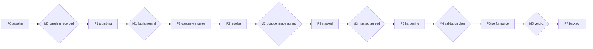

# Visibility Buffer — Implementation Plan

Companion to [visibility_buffer_analysis.md](visibility_buffer_analysis.md). The analysis explains
*why* variant A (visibility buffer → existing G-buffer resolve) was chosen; this document is the
work breakdown: phases, tasks, milestones, and the capture-based checks that decide whether each
phase is actually done.

Status: planning only. No renderer code has been changed.

---

## Table of Contents

1. [Conventions](#1-conventions)
2. [Baseline and preconditions](#2-baseline-and-preconditions)
3. [Milestones at a glance](#3-milestones-at-a-glance)
4. [Phase 0 — Baseline and instrumentation](#4-phase-0--baseline-and-instrumentation)
5. [Phase 1 — Render-graph plumbing and the flag](#5-phase-1--render-graph-plumbing-and-the-flag)
6. [Phase 2 — Opaque cluster visibility raster](#6-phase-2--opaque-cluster-visibility-raster)
7. [Phase 3 — The resolve](#7-phase-3--the-resolve)
8. [Phase 4 — Masked bucket](#8-phase-4--masked-bucket)
9. [Phase 5 — Correctness hardening](#9-phase-5--correctness-hardening)
10. [Phase 6 — Performance verdict](#10-phase-6--performance-verdict)
11. [Phase 7 — Optional backlog](#11-phase-7--optional-backlog)
12. [Correctness and performance with captures](#12-correctness-and-performance-with-captures)
13. [File-touch matrix and build order](#13-file-touch-matrix-and-build-order)
14. [Risk register](#14-risk-register)
15. [Appendix A — command cheat sheet](#15-appendix-a--command-cheat-sheet)
16. [Appendix B — reference cross-map](#16-appendix-b--reference-cross-map)
17. [Appendix C — per-phase gate checklist](#17-appendix-c--per-phase-gate-checklist)

---

## 1. Conventions

### 1.1 Task ids are plan bookkeeping only

Tasks are numbered (`P2.3`) so the checklist in Appendix C can reference them. **Do not copy a
task id, phase number or milestone id into a code comment or a test name** — this repository's
comment policy bans provenance stamps. Put `docs/visibility_buffer_implementation_plan.md` in the
commit message instead.

### 1.2 Exactness classes

Every validation step below names the class it must satisfy. This matters because a visibility
buffer *cannot* be bit-identical to the raster path everywhere: texture LOD comes from an analytic
gradient estimate rather than the hardware's footprint.

| Class | Meaning | Applies to |
|---|---|---|
| **A — bit-identical** | 0 differing bytes/pixels | depth buffer, cluster cut counts, `--vis-buffer 0` against the current build, every pass that should not move (Deferred, RTXDI, NRD, TAA, sky, transparent) |
| **B — bounded** | differing pixels under a stated budget, and the differences are explainable (triangle edges, texture LOD) | the six G-buffer debug views, the composite at a fixed pose |
| **C — expected to differ** | documented, not a gate | sampler-feedback tile sets, mip level choice on oblique surfaces, per-pixel A/B heat maps |

### 1.3 Feature-flag discipline

- One switch: `Config::m_EnableVisibilityBuffer`, `--vis-buffer <0|1>`, **default 1** since M5
  (Phase 6 recorded the measurements the flip was taken on); `--vis-buffer 0` is the raster
  reference and stays supported.
- With the flag off, the build must be behaviourally identical to the commit before the work
  started (Class A, checked at every milestone).
- Nothing in the vis path may become load-bearing for non-vis paths. If a shared function has to
  change (e.g. a streaming sampler helper), it is added, not modified in place.

### 1.4 Definition of "done" for a task

A task is done when (a) it compiles in Debug with `--rhidebug` reporting 0 D3D12 errors, (b) its
row in the phase table's *Done when* column is satisfied, and (c) the phase's milestone was run
with flags identical to the recorded baseline commands.

---

## 2. Baseline and preconditions

Do this **before the first code edit**. Without it, no later comparison has a reference.

### 2.1 Build and environment preconditions

```powershell
# from the repo root; a new .cpp under src/ is globbed, but only after a reconfigure
cmake -S . -B build
cmake --build build --config Debug --target build_srrhi
cmake --build build --config Debug --target build_shaderids
cmake --build build --config Debug --target build_shaders
cmake --build build --config Debug --target HobbyRenderer
```

- Build order is enforced by CMake: `build_srrhi → build_shaderids → build_shaders → exe`. Never
  hand-edit `src/shaders/srrhi/**` or `src/shaders/ShaderIDs.h`.
- Debug builds are the ones that run on this machine; Release still dies in the driver after a few
  frames (recorded in the repo's cluster notes).
- Scenes live in `D:\Workspace\GLTF Scenes`; run from `D:\Workspace` so relative scene paths work.
- Before each capture run, restore the camera pose: every run **overwrites**
  `bin/camera_state.json` on exit, so copy a saved pose back or use a fixed pose per capture pair.

### 2.2 Baseline artefacts to record (Task P0.1)

| Artefact | How |
|---|---|
| Screenshots, per scene | `--hide-ui --screenshot-frame 60` on `--vis-buffer 0` (baseline) |
| Debug views 3/4/5/6/7 | `--hide-ui --debug <n> --screenshot-frame 60` |
| Cluster cut reference | `--cluster-no-culling --cluster-stats-frame 5` log line per scene |
| GPU pass timings | the ImGui pass panel or the CSV dump (`bin/ev90_cb.csv` style), plus `--hitch-log` off |
| PIX frame capture | `--pix-capture-frame 90`, event list with `gpu__*`, `smsp__inst_executed.sum`, `l1tex__t_sectors.sum`, `dram__bytes.sum` |
| RenderDoc frame capture | `--renderdoc-capture-frame 90`, `verify` + `summary` + `hazards` + `samplers` + `rootsig-check` transcripts |

Reference set (cheap → expensive): `Cornell` (deterministic, tiny), `bunny` (per-corner normals,
simplification stress), `Sponza` (masked geometry, large distant triangles), `Bistro/bistrox`
(props = small triangles, the performance case), `DragonAttenuation` (no alpha test),
`threedscans_animals` (6M+ vertices, the dense-cluster case).

**Disk note:** a Bistro frame capture is ~1.3 GB and a frame-0 (load) capture ~177 MB. Do the A/B
image work on Cornell/Sponza and keep Bistro for the performance run; delete captures after each
milestone.

### 2.3 Known capture constraints (read before Phase 0)

- PIX and RenderDoc hook the same queue; their brackets are mutually exclusive and the renderer
  asserts this. Never enable both in one run.
- A capture stalls the captured frame, so **never** use a capture run for time measurements. Time
  comes from the engine's own GPU timers; captures explain *why*.
- Loading `renderdoc.dll` clamps the device to DXR 1.1 and disables sampler feedback, so a `.rdc`
  cannot show OMM or the streaming material path. Streaming validation must be done in PIX or in
  the running app with logs.
- `pixtool save-screenshot` is broken on this machine; use `save-resource --rtv=0` or the app's
  `--screenshot-frame`.

---

## 3. Milestones at a glance



| Milestone | After | Pass criteria | Tools |
|---|---|---|---|
| **M0** | P0 | Baseline artefacts exist for all six scenes; **cluster counters are exact** across runs; debug-view images are bit-exact only when texture residency has settled (measured: Cornell/animals yes, Bistro no) — so image gates use a pixel budget, never a hash | app, PIX, RenderDoc |
| **M1** | P1 | `--vis-buffer 1` is Class A identical to `--vis-buffer 0` (the pass is declared but not ordered) | app, `passdiff` |
| **M2** | P3 | Depth **Class A** identical; debug views 3/4/5/6/7 **Class B** within budget; composite **Class B**; `hazards`/`rootsig-check`/`crosscheck` clean | PIX, RenderDoc, `rdc-tools` |
| **M3** | P4 | Masked silhouettes and mode-4 view **Class B**; depth still **Class A** | same |
| **M4** | P5 | Zero validation errors, no new hazard findings, streaming converges, motion/TAA stable, `--cluster-no-culling` still `(match)` | all |
| **M5** | P6 | Per-pass work and frame time measured and the keep/revert/default decision recorded | PIX counters + engine timers |

---

## 4. Phase 0 — Baseline and instrumentation

No renderer behaviour changes. Everything here is additive.

| Task | Work | Files | Done when |
|---|---|---|---|
| P0.1 | Record the baseline artefact set of §2.2 | — | files exist under `bin\baseline\` (create it), with a small `README.txt` naming the flags used |
| P0.2 | Add the `--vis-buffer-stats-frame <n>` config field and help line (the readback itself lands with the resolve) | `src/Config.h`, `src/Config.cpp` | flag parses; help text lists it |
| P0.3 | Confirm the PIX and `rdc-tools` workflows end-to-end on the *current* build | — | `perform-single-playback` exit 0; `verify` prints `problems: 0` |

**Reference checkpoints**

- Filmic Worlds part 1: the pass taxonomy (`PrePass`, `Material`, `Lighting`, `VisUtil`, `Other`)
  is the vocabulary the timings in this plan use; adopt it so numbers are comparable to the
  article's.
- `D3D12_Research/Resources/Shaders/VisibilityGBuffer.hlsl`: the *shape* of the resolve pass this
  plan builds (vis texture → triangle fetch → G-buffer), useful as a second opinion on structure.
- The-Forge `VisibilityBufferShaderDefs.h.fsl`: the bit-field macro style; do not copy the 23-bit
  batch id, this renderer uses a job index (§2 of the analysis).

**Validation:** re-run P0.3 twice; the event counts and marker counts must match, and the PIX
control passes (Deferred, REBLUR, TAA) must be ×1.000 between the two runs.

---

## 5. Phase 1 — Render-graph plumbing and the flag

Goal: the visibility texture exists, is cleared, and nothing reads it. Flag on must be Class A
identical.

| Task | Work | Files | Done when |
|---|---|---|---|
| P1.1 | Add `Config::m_EnableVisibilityBuffer` (default `false`), `--vis-buffer <0\|1>`, help line | `src/Config.h`, `src/Config.cpp` | `--help` lists it; default run unchanged |
| P1.2 | Declare `g_RG_VisibilityBuffer` (`R32_UINT`, `isRenderTarget`, `keepInitialState`), clear to 0 | `src/CommonRenderers.cpp` | the texture appears in the render-graph UI; `--vis-buffer 0` unaffected |
| P1.3 | Add a `VisibilityResolveRenderer` that registers, orders after `MaskedPassRenderer`, and `Setup()` returns `false` when the flag is off | new `src/VisibilityResolveRenderer.cpp`, `src/Renderer.cpp` | the pass appears in the panel as disabled; image identical |
| P1.4 | Add the ImGui checkbox next to "Use Meshlet Rendering" / "Enable Cluster LOD" | `src/ImGuiLayer.cpp` | toggling does not change the image |
| P1.5 | Add the PIX marker names `VisibilityRaster` (around the cluster dispatch) and `VisibilityResolve` (around the resolve) in the code now, so the capture vocabulary is stable from the first capture on | `src/BasePassRenderer.cpp`, new renderer | both names appear in a PIX event list when the flag is on |

**Reference checkpoints**

- Analysis §3.4: the renderer order and why the resolve must sit after `MaskedPass` and before
  `RTXDI`/`SHARC`.
- `src/CommonRenderers.cpp` `ClearRenderer::Setup` for the declaration style; `nvrhi::Format::R32_UINT`
  and `clearTextureUInt` are already used for buffers, the texture form is the same call.

**Validation (M1)**

1. `--vis-buffer 0` vs `--vis-buffer 1` at the same pose: `--hide-ui --screenshot-frame 60`,
   compare with the existing image compare used for the FSR/cluster work; expect 0.
2. RenderDoc `passdiff` between the two captures: identical pass trees, only the disabled marker.
3. `--rhidebug` on both: 0 D3D12 errors.

**Result (measured 2026-11-26).** M1 passes, with three findings worth keeping:

| Check | Result |
|---|---|
| `--debug 4 --no-taa`, Cornell, flag off vs on | **identical** (SHA-256 `258CD73F…`), and equal to the Phase 0 baseline hash → the off path is unchanged |
| Composite, flag off, two runs | differ — the composite is not a usable channel (see the baseline README); M1 must be gated on a debug view |
| `--rhidebug` full frame, flag on | exit 0, 0 assertions, 0 error lines |
| `--rendergraph-strict-access`, flag on | exit 0, 0 asserts |
| `--rhidebug --rhidebug-gpu` on a minimal frame (`--no-indirect --no-denoise --no-restir-di --no-sky --no-taa`) | exit 0, 0 asserts |
| `--rhidebug --rhidebug-gpu` full frame | dies in D3D12 GPU-based validation instrumentation (`!dbg attachment points at wrong subprogram`, LLVM dump); **also dies with `--vis-buffer 0`** → pre-existing, not this work |
| `--rendergraph-own-barriers`, `--cluster 0`, `--execute-per-pass` with the flag on | all exit 0 |

The one real bug the layers caught: an integer target cleared through nvrhi's render-target path
issues `ClearRenderTargetView` with float values on `R32_UINT`, which D3D12 rejects at the first
frame. The target therefore carries the UAV flag and `UnorderedAccess` as its initial state, so
`clearTextureUInt` takes the `ClearUnorderedAccessViewUint` path.

Capture evidence (Cornell frame 30, `--vis-buffer` off/on):

- **PIX**: GPU order is `Opaque Renderer` (row 39) → `MaskedPass` (279) → `Visibility Resolve`
  (289) → `HZBGeneratorPhase2` (304). The on capture has +25 API events and **no new draws or
  dispatches**: one `ClearUnorderedAccessViewUint`, one command list (Reset/Close/SetDescriptorHeaps/
  ResolveQueryData), the rest timer queries. Every pre-existing pass is ×1.0000 instructions in the
  counter A/B; the new marker rows are 56 + 14 instructions. With the flag off neither marker exists
  (1168 events; on: 1193).
- **RenderDoc**: `verify` → `problems: 0`; the action list places `VisibilityRaster` inside the
  opaque pass and `Visibility Resolve` / `VisibilityResolve` between `MaskedPass` and
  `HZBGeneratorPhase2`. `replay_dump counters --per-pass` publishes counters but produces no results
  for this capture, so PIX stays the counter source. `passdiff` is not a usable verdict for this pair
  (the added pass shifts event numbering; it reported added/removed paths on both sides).

**Rollback:** the flag defaults off, so a failed M1 costs nothing but the two new files.

---

## 6. Phase 2 — Opaque cluster visibility raster

Goal: the opaque cluster bucket writes ids instead of G-buffer values. Nothing changes visually yet
because the resolve is not enabled — so gate this phase on the *buffer contents*, not on the image.

| Task | Work | Files | Done when |
|---|---|---|---|
| P2.1 | New `src/shaders/ClusterVis.hlsl`: `ASMain` unchanged in behaviour; `MSMain` writes a reduced `VSOutVis` (position + uv) and a per-primitive `{ triangleIndex }`; `PSMain` returns the packed id | `src/shaders/ClusterVis.hlsl`, `src/shaders/shaders.cfg` | shaders compile; new `ShaderID::CLUSTERVIS_*` entries exist |
| P2.2 | Carry the job index: add `m_JobIndex` to the mesh payload in the AS (the AS already reads `g_ClusterJobs[groupId.x]`) | `ClusterVis.hlsl` | the value equals `groupId.x` for every cluster (asserted in a debug path) |
| P2.3 | Pack `list:2 \| (job+1):23 \| triangle:7`, list 0 = opaque pass 1 | `ClusterVis.hlsl` | the id is non-zero for every covered pixel; empty = 0 |
| P2.4 | Draw branch: when the flag is on, build the mesh pipeline against a framebuffer of `{ vis, depth }`, `DepthReadWrite` + stencil replace 1, and **skip** the G-buffer attachments | `src/BasePassRenderer.cpp` | one MRT bound in the capture; stencil still 1 |
| P2.5 | `Setup()`: when the flag is on, the opaque bucket declares vis writes instead of G-buffer writes | `src/BasePassRenderer.cpp` | render graph shows no opaque→G-buffer edge |
| P2.6 | Second ("revived") pass writes list 1 | `src/BasePassRenderer.cpp` | both lists appear in the capture |
| P2.7 | Resolve stub: a temporary "visualise id" pass that writes `hash(id)` into albedo, so the ids can be looked at before the real resolve exists (view it with `--debug 4`; the other five targets stay empty until phase 3) | new renderer/shader | a hash-coloured image with clean cluster boundaries |

**Reference checkpoints**

- Xbox sample `Source/VisibilityMS.hlsl`: the exact `out primitives PrimitiveAttributes
  sharedPrimitives[MAX_PRIMITIVES]` pattern and the `SetMeshOutputCounts` ordering. This is the
  mechanism, not a suggestion.
- Xbox sample `Source/VisibilityPS.hlsl`: the "biased id so 0 means empty" convention
  (`(objectIndex + 1) & 0xfff`).
- `D3D12_Research/Resources/Shaders/VisibilityBuffer.hlsli`: the 7-bit primitive + 25-bit candidate
  packing (`primitiveID & 0x7F`, `candidateIndex = data >> 7`, `candidateIndex -= 1`).
- `src/shaders/ClusterBasePass.hlsl`: the cluster record decode (`ClusterStreamBase`, micro-index
  fetch) that the reduced MS keeps verbatim.
- Mesh shader spec ("SV_PrimitiveID in the Pixel Shader"): there is no system primitive id; the
  per-primitive output is the only route.

**Validation (P2 gate, before the resolve)**

1. **Vis buffer contents, numerically.** RenderDoc: `replay_dump textures <rdc> "VisibilityBuffer"
   --save bin\visdump --raw` then read the `.bin` (R32_UINT, one word per pixel) with Python;
   assert sampled pixels decode to a job index that maps back to the cluster covering a known
   screen point. Cross-check one pixel with `replay_dump trace <rdc> <eid> --pixel x,y`.
2. **Coverage.** The count of non-zero words must equal the number of pixels the baseline G-buffer
   says have a surface (albedo alpha or stencil 1). Reasonable slack on triangle edges; a large
   delta means the MS dropped primitives.
3. **Depth.** Compare the depth target between vis mode and baseline: **Class A** identical. This
   is the strongest single check that the reduced vertex output uses the same transform maths.
4. **PIX per-pass image:** `save-resource bin\vis.dds --marker=VisibilityRaster --rtv=0`, then
   convert/inspect; a `.dds` keeps the DXGI format.
5. **Cluster cut unchanged:** `--cluster-no-culling --cluster-stats-frame 5` still says `(match)`.

**Result (measured 2026-11-26).** Phase 2 is in: the opaque cluster bucket writes ids, and the resolve turns them
into the albedo target as a hash colour. As built, in the order it mattered:

| Task | As built |
|---|---|
| P2.1 | `src/shaders/ClusterVis.hlsl` — AS/MS/PS, `out primitives`, registered in `shaders.cfg` as `CLUSTERVIS_*` |
| P2.2 | the job index rides in `ClusterVisPayload` from `groupId.x` and out through the per-primitive struct: a mesh pipeline's pixel shader has no `SV_PrimitiveID` of its own, so `SV_PrimitiveID` is *carried* in the primitive output, as the Xbox sample does |
| P2.3 | `list:2 \| (job+1):23 \| triangle:7`; the list index is a new `BasePassConstants::m_VisListIndex` in `BasePass.sr` (the per-frame CB, not the cooked-mesh layout in `Cluster.sr`) |
| P2.4 | a `bVisPath` branch selects a `{ R32_UINT, depth }` framebuffer and the ClusterVis pipeline; the depth/stencil state is the raster path's, so stencil 1 still marks the same surfaces |
| P2.5 | `OpaqueRenderer::Setup` declares the id write *instead of* the six G-buffer writes, and `Render` stops asking for them (asking for a write it did not declare is an error) |
| P2.6 | the revived pass sets `m_VisListIndex = 1` |
| P2.7 | `VisibilityResolveRenderer` + `VisibilityResolve.hlsl/.sr`: `Load` the id, write `HashColor(id)` into albedo, black where it is 0 |

What the plan did not anticipate:

- **`--debug <n>` runs a different schedule** (`Renderer::ScheduleDebugView`), and it did not include the resolve —
  so the albedo stayed at its clear value and the id view was black. The resolve is now in that list; it gates
  itself on the same switch, so the raster path's debug views are unchanged.
- **The two cluster overlays (modes 14/15) write six G-buffer targets** and would fail pipeline creation against a
  single id target, so they are skipped on the id path.
- **`list` and `triangle` are reserved words in HLSL**; the packing locals are `idList` and `triangleIndex`.
- `HashColor` moved to `Common.hlsli` (it was `BasePassCommon`'s, and the resolve is not a base-pass shader).
- `Renderer::IsVisibilityBufferActive()` is `flag && cluster draw`: with `--cluster 0` there is no raster to write
  ids, so the switch falls back to the raster path instead of letting the resolve draw a cleared buffer.

Correctness (Cornell, frame 60, RenderDoc + PIX):

| Check | Result |
|---|---|
| depth `D24S8`, vis on vs off | **bit-identical**: 0 differing bytes of 8,294,400 |
| surface coverage | stencil == 1: **354,070** px; non-zero ids: **354,070** px — exact |
| resolve decode | albedo equals `HashColor(id)` at **all 2,073,600** pixels, 0 mismatches, alpha 255 everywhere |
| id histogram | list bits all 0, `job+1` in 1..3, `triangle` 0..29, 16 distinct ids |
| PIX `save-resource --marker=VisibilityRaster --rtv=0` | 354,073 non-zero words (the 3 extra are the DDS tail/capture timing), same histogram — the two tools agree to 0.0008 % |
| `--cluster-no-culling --cluster-stats-frame 5` | `(match)` |
| `--cluster 0 --vis-buffer 1` vs `0` (`--debug 4`) | **identical** hash `258CD73F…` — the fallback is clean |
| `--vis-buffer 0` (`--debug 4`) | `258CD73F…`, the Phase 0 baseline hash — the off path is untouched |
| `--rhidebug` | exit 0, 0 asserts, 0 D3D12 messages |
| `--rhidebug --rhidebug-gpu` on the minimal frame, flag on and off | exit 0, 0 asserts |
| `rdc-tools verify` | `problems: 0` (1 padding note) |
| `rdc-tools hazards` | 4 findings (2 distinct) on the HZB at the SPD mip dispatch — **same count and shape as the raster-path capture**, so no new finding |
| `replay_dump crosscheck` | 56 findings, all the pre-existing "cluster binding outside the root signature's declared range" class (raster capture: 104); no target/format finding, 50 targets checked |
| `rootsig-check` / `samplers` | notes only; **0 samplers bound at the sampled events** — the id path samples nothing, which is the point |

Performance (Cornell frame 60, full schedule, PIX `smsp__inst_executed.sum` / `l1tex__t_sectors.sum` per
top-level pass):

| Pass | inst off | inst on | ratio | sectors off | sectors on | ratio |
|---|---|---|---|---|---|---|
| Opaque Renderer | 5,685,631 | 1,963,982 | **0.3454** | 2,558,951 | 1,290,634 | **0.5044** |
| Visibility Resolve | — | 1,216,771 | new | — | 518,406 | new |
| SHARCRenderer | 4,319,033 | 1,711,549 | 0.3963 | 2,100,898 | 1,348,287 | 0.6418 |
| RTXDIRenderer | 267,440,382 | 263,083,338 | 0.9837 | 92,294,340 | 90,333,300 | 0.9788 |
| HDRPostProcess | 7,850,611 | 7,813,351 | 0.9953 | 1,559,139 | 1,559,139 | 1.0000 |
| Sky / Bloom / Deferred / FSR3 TAA / TLAS | | | **1.0000** | | | 1.0000 |
| HZBGeneratorPhase2 | 1,820,370 | 1,822,545 | 1.0012 | 1,289,871 | 1,288,125 | 0.9986 |
| **totals** | 1,393,509,101 | 1,353,557,522 | **0.9713** | 529,052,766 | 507,164,906 | **0.9586** |

The controls are ×1.0000, so the A/B is valid. The raster loses two thirds of its instructions and half its
sectors: the material sampling left it. The new resolve is 1.2 M instructions — one `Load` and one store per
pixel, no material work. `SHARCRenderer` and `RTXDIRenderer` move because this phase's resolve writes *albedo
only*, so the normals they read are the clear value; that is the intermediate state, not a verdict. The
performance decision belongs to Phase 6, when the resolve writes all six targets.

Two things to carry forward. `--rendergraph-strict-access` reports one new warning — *"pass 'Opaque Renderer'
declares a write of texture 'VisibilityBuffer_RG' but never binds it"* — because the checker only sees the
resources the pass's *helper* passes (the HZB compute) bind, not the mesh state; the identical warning already
exists for `HDRPostProcess`/`ExposureTexture`. And the revived pass' list 1 has no pixels in any capture so far:
with a settled camera it is empty by construction, so it needs a moving-camera capture to be observed.

**Rollback:** flag off restores the old framebuffer and PS selection in one branch; delete the
shader if the phase is abandoned.

---

## 7. Phase 3 — The resolve

Goal: the six G-buffer targets are written from the vis buffer, and the composite matches the
baseline within the Class B budget.

| Task | Work | Files | Done when |
|---|---|---|---|
| P3.1 | Port the corrected `CalcFullBary` (McLaren/Hill) into a shared include | `src/shaders/VisibilityResolve.hlsl` (or `CommonLighting.hlsli`) | unit-checked against a known triangle (see below) |
| P3.2 | `VisibilityResolve.sr`: per-frame constants + vis/job/record/group-state/stream/instance/material/vertex bindings | `src/shaders/VisibilityResolve.sr` | `build_srrhi` generates the C++/HLSL glue |
| P3.3 | Resolve PS: decode → job → cluster record → 3 micro-indices → 3 vertices → clip positions → barycentrics/derivatives → interpolate | `VisibilityResolve.hlsl` | debug view 4/3 matches baseline Class B |
| P3.4 | Material fetch: texture-flag logic of `GBuffer_PSMain`, using the gradient streamed sampler | `VisibilityResolve.hlsl`, `src/shaders/Bindless.hlsli` (new helper) | ORM/emissive views match; no sampler-feedback mip violations in `samplers` |
| P3.5 | Write all six targets, including `GeoNormal` (interpolated vertex normal — *not* the face normal) and motion vectors via `ComputeMotionVectors` | `VisibilityResolve.hlsl` | mode 9 (motion) matches; RTXDI's geo-normal history has no edge noise |
| P3.6 | Port the debug-colour block for modes 1, 2, 8, 12, 13 and streaming-mip 11 | `VisibilityResolve.hlsl` | each mode matches the baseline view |
| P3.7 | Schedule the pass; declare vis read + six writes when enabled | `src/VisibilityResolveRenderer.cpp` | pass appears between `MaskedPass` and `RTXDI` in the capture |

**Reference checkpoints**

- Filmic Worlds part 1, "Interpolation and Analytic Partial Derivatives": the corrected
  `CalcFullBary` and the chain-rule rule ("apply derivatives to the values on the path to the
  texture sample, then `SampleGrad`").
- The-Forge `VisibilityBufferShadingUtilities.h.fsl`: `CalcFullBary`, `InterpolateWithDeriv`,
  `Interpolate2DWithDeriv`, `Cal3DDeriv`, `perturb_normal` — a working implementation of the same
  maths; compare your port line by line.
- Xbox sample `Source/SceneReconstructionCS.hlsl`: the `WaveActiveAllEqual(visibility)` fast path
  and the ray/plane fallback, plus the warning that neighbour values are read **before** any
  early-out.
- `D3D12_Research/Resources/Shaders/VisibilityBuffer.hlsli` `ComputeBarycentrics`: a third
  independent derivation; useful to confirm the NDC-to-pixel scale and the `ddy` sign.
- Analysis §5.7 for why `SampleGrad` alone is not enough with streaming textures.

**Barycentric unit check (do this before looking at a frame)**

Pick a known triangle from the cluster records, compute `m_lambda` at a known pixel on the CPU with
the same formula, and compare against the resolve's value via `replay_dump trace --pixel`. A
transposed 2×2 determinant or a missing `2/viewport` scale fails this immediately and looks like
"textures are blurry / wrong mip" in a frame check, which wastes time.

**Validation (M2)**

1. Depth **Class A** (still identical — the resolve does not touch it).
2. Debug views: `--debug 4` (albedo), `3` (world normals), `5` (roughness), `6` (metallic),
   `7` (emissive), `9` (motion) — Class B on Cornell/Sponza, and the difference map concentrated on
   triangle edges, not on interiors.
3. Composite: Class B at a fixed pose with `--no-auto-exposure --disable-sampler-feedback` on both
   sides.
4. `rdc-tools`: `verify` (`problems: 0`), `hazards` (no findings beyond the 8 pre-existing bindless
   artefacts), `rootsig-check` (resolve bindings match its signature), `samplers` (no `certain`
   verdict), `vram` (report the new texture's cost).
5. `replay_dump crosscheck <rdc>` — render-target formats against the resolve PS output signature
   (one `R32_UINT` plus the six G-buffer formats).
6. PIX `perform-single-playback` exit 0.

**Result (measured 2026-11-26).** Phase 3 is in: the resolve decodes the id, rebuilds the interpolant from the
triangle and writes all six G-buffer targets. As built:

| Task | As built |
|---|---|
| P3.1 | no separate port: the barycentrics are the signed-area form in screen space, then `1/w` weighting, and they live in `VisibilityResolve.hlsl` because nothing else needs them |
| P3.2 | `VisibilityResolve.sr` holds **only** the id texture, in `[space(1)]`; the pass binds `srrhi::BasePassInputs` at space 0, so the material evaluation is the raster path's own code on the same bindings |
| P3.3 | decode → `ClusterJob` → `ClusterRecord` → `ClusterStreamBase` → 3 micro-indices → 3 vertices → `PrepareVSOut`'s per-vertex transform and tangent frame → 2D barycentrics → `1/w` weights |
| P3.4 | the material block **moved** into `src/shaders/GBufferMaterial.hlsli` (`EvaluateGBufferMaterial`), so the raster path and the resolve are one implementation; the streamed sampler is used unchanged (implicit derivatives of the reconstructed uv, and it writes the sampler feedback residency needs) |
| P3.5 | all six targets, including `GeoNormal` from the interpolated vertex normal and motion vectors through `ComputeMotionVectors` |
| P3.6 | the debug-colour block came along with the move, so modes 1/2/8/12/13 and the streaming-mip view work in both paths |
| P3.7 | scheduled and declared: id read, both job lists read, six G-buffer writes |

Three things that had to be added to make that shape work, none of them in the plan:

- **The resolve has to reach the job list the raster drew from.** A `ClusterRecord` does not name its instance, so
  the id is a slot in the *raster's* list, and the list lives in the base pass' own transients. The pass that fills
  a list now publishes it in `g_RG_VisClusterJobLists` (`BasePassCommon.h`, one handle per id list), and
  `BasePass.sr` gained a `ClusterJobsSecond` slot for list 1 — the resolve reads both because one frame can hold
  ids from both opaque lists.
- **The G-buffer's size travels in `BasePassConstants`** (`m_Width`/`m_Height`): the resolve turns clip positions
  into pixel centres and must not ask a texture for its dimensions.
- **`EvaluateGBufferMaterial` cannot discard and keep `[earlydepthstencil]`**, which the streamed sampler needs, so
  an empty id returns the zero target instead of discarding. That is the raster path's clear value, so the result is
  the same; it also means this phase leaves masked geometry's pixels at zero, because the resolve writes every
  pixel the ids do not cover. Phase 4 is what fixes that, and it is why Sponza's foliage/railings are missing with
  the flag on today.

Correctness (RenderDoc, `--debug 4`, same frame and pose, G-buffer dumps compared byte by byte):

| Target | Cornell | Sponza (textured, grazing floor) |
|---|---|---|
| Albedo | **bit-identical** | 0.79 % differ, 53 % of them on an id boundary, worst byte delta 39 |
| Normals | **bit-identical** | 2.32 % differ, mostly 1 LSB (24 k of 48 k), worst 255 at mip transitions |
| GeoNormals | **bit-identical** | **bit-identical** |
| ORM | **bit-identical** | 0.52 % differ, 76 % on an id boundary, worst 49 |
| Emissive | **bit-identical** | **bit-identical** |
| Motion | 17 % differ, ≤ 0.16 px (p99 = 0.037, p99.9 = 0.062) | same shape |

The two bit-identical targets are the proof: `GeoNormal` is `EncodeNormal(normalize(interpolatedNormal))`, so the
reconstructed vertex interpolation and the weights are exact; `Emissive` covers the untextured factor path. What
differs on Sponza is the *texture sampling* — `Sample` with implicit derivatives on a surface seen at a grazing
angle picks a neighbouring mip, which is the Class C difference the plan predicted, not an interpolation error.
Motion vectors differ only where the motion itself is a fraction of a pixel, and by less than 0.16 px at worst.

Gates: `--rhidebug` exit 0 with 0 asserts; `--rendergraph-strict-access` 0 asserts (only the two known
"declares a write it never binds" warnings, both pre-existing shapes); `--rhidebug-gpu` on the minimal frame exit 0
with the flag on and off; `--cluster-no-culling --cluster-stats-frame 5` still `(match)`; `--vis-buffer 0` still
hashes `258CD73F…`; `--cluster-two-pass 1`, `--cluster-draw 0` and `--no-indirect --no-denoise --no-sky` all exit 0.
`rdc-tools`: `verify` 0 problems; `hazards` the same 4 findings (2 distinct, HZB/SPD) as both earlier captures;
`rootsig-check` notes only; `crosscheck` 110 targets, no target/format finding; `samplers` reports 0 samplers at the
sampled events because Cornell has no textures — the textured case is the Sponza capture above.

Performance (Cornell frame 60, normal schedule, PIX `smsp__inst_executed.sum` / `l1tex__t_sectors.sum`):

| Pass | inst off | inst on | ratio | sectors off | sectors on | ratio |
|---|---|---|---|---|---|---|
| Opaque Renderer | 5,654,595 | 1,965,942 | **0.3477** | 2,619,148 | 1,290,560 | **0.4927** |
| Visibility Resolve | — | 15,276,631 | new | — | 3,142,038 | new |
| Sky / Bloom / Deferred / FSR3 TAA / TLAS / HDR | | | **1.0000** | | | 1.0000 |
| SHARCRenderer | 4,287,961 | 4,291,454 | 1.0008 | 2,099,043 | 2,102,193 | 1.0015 |
| HZBGeneratorPhase2 | 1,820,246 | 1,821,424 | 1.0006 | 1,289,997 | 1,288,172 | 0.9986 |
| RTXDIRenderer | 260,186,968 | 267,438,590 | 1.0279 | 92,296,834 | 92,553,233 | 1.0028 |

That `SHARCRenderer` is back to ×1.000 — after phase 2's ×0.40, when the normals it reads were the clear value — is
the counter-side confirmation that the G-buffer is real again. RTXDI's instruction count moves between repeated
identical runs by this much (its two "off" captures measured 260.2 M and 267.4 M), while its sector count is
reproducible to 0.3 %, so its row is noise, not a regression.

The raster's saving is 3.7 M instructions and 1.3 M sectors; the resolve costs 15.3 M and 3.1 M. On Cornell — a few
dozen enormous triangles filling the screen, where the Filmic Worlds prior says a visibility buffer is a wash — the
net is *more* work. That is the expected shape of the intermediate result, not the verdict: Phase 6 measures a dense
scene (Bistro, animals), which is where the per-pixel win is supposed to appear.

**Rollback:** delete `VisibilityResolveRenderer` from the schedule and the flag stays a no-op; the G-buffer material
code is shared, so the raster path keeps working untouched.

---

## 8. Phase 4 — Masked bucket

Goal: alpha-tested geometry enters the vis buffer with the test resolved in the raster pass.

| Task | Work | Files | Done when |
|---|---|---|---|
| P4.1 | `PSMainAlphaTest`: sample the albedo alpha and `discard`, then write the id with list 2 | `ClusterVis.hlsl` | discarded texels leave the id at 0 behind the fragment that wins depth |
| P4.2 | Masked bucket's `Setup()`/draw branch mirror P2.4–P2.6 | `src/BasePassRenderer.cpp` | masked pass binds `{ vis, depth }` only |
| P4.3 | Bind the masked job list to the resolve; decode list id 2 | `src/VisibilityResolveRenderer.cpp` | masked pixels resolve; no id from the wrong list |
| P4.4 | Streaming for the alpha texture: the vis PS uses the implicit-derivative streamed sampler (it is a pixel shader, so it can) | `ClusterVis.hlsl` | residency behaves as before; no missing tiles on foliage |

**Reference checkpoints**

- Analysis §5.3: why the test cannot be deferred (a discard in the resolve would expose nothing
  behind it).
- Nanite technical docs: materials restricted to Opaque/Masked, and masked geometry resolved
  during rasterisation ("programmable raster") for exactly this reason.
- `src/shaders/BasePass.hlsl` `GBuffer_PSMain_AlphaTest`: the existing alpha logic to mirror
  (`alpha = albedo.w * baseColor.w`, compare against `m_AlphaCutoff`).

**Validation (M3)**

1. Depth still Class A.
2. `--debug 4` on Sponza's foliage/railings: Class B, and specifically check the *silhouette*, not
   just the interior — the failure mode is a fringe of missing or extra texels.
3. A vis-buffer dump at a leaf edge: ids on one side of the edge, 0 on the other, with no
   half-tested texels surviving.
4. `samplers` on the new capture: same verdict as baseline.

**Result (measured 2026-11-27).** The masked bucket is on the id path:

| Task | As built |
|---|---|
| P4.1 | `PSMainAlphaTest` in `ClusterVis.hlsl` (`CLUSTERVIS_PSMAINALPHATEST_ALPHATEST_ALPHA_TEST_1`): it samples the albedo through the same streamed sampler with the rasteriser's own interpolated uv, so its decision matches the raster's texel for texel; the rule itself (`AlbedoAlpha`, `MaterialHasAlbedo`) moved into `GBufferMaterial.hlsli` so the two paths share it rather than agreeing by inspection |
| P4.2 | `bVisPath` now covers every cluster bucket except the blended one, so the masked pass selects the same framebuffer and declares/fetches the id target instead of the G-buffer |
| P4.3 | the masked pass publishes its list as `g_RG_VisClusterJobLists[2]`; the resolve binds it (`ClusterJobsMasked`, `t20`) and decodes list id 2 |
| P4.4 | the alpha sample is a pixel-shader sample with implicit derivatives, which is what writes the sampler feedback the streaming needs — and it resolves the same mips the raster path does because the uv is the rasteriser's |

**A build bug this phase found, and fixed.** Adding the alpha variant made the app assert `Failed to read shader
file`: `ShaderIDsGenerator` composed the dxil path as `<stem>_<entry><suffix>.dxil` while ShaderMake writes
`<stem><suffix>_<entry>.dxil`. For the two *pre-existing* suffixed entries the registered path happened to exist as a
4-day-old file, so the masked raster shader and the **transparent bucket** had been loading stale binaries — which is
why this phase's first Sponza run died instead of quietly shading with them. `ComputeOutputFile` in
`ShaderIDsGenerator/src/main.cpp` now composes stem + suffix + entry. Keys and PIX marker names are unchanged; only
the registered paths move, and they now name files the compiler actually writes.

Validation:

| Check | Result |
|---|---|
| id lists, Bistro frame 60 | 1,930,390 list-0 px + **143,210 list-2 px** — the masked bucket is in view and does resolve |
| depth, vis on vs off (Bistro) | 11,720 px differ — **the same magnitude as raster vs raster (11,972)**, so it is this scene's streaming-driven alpha-test instability, not this path |
| GeoNormals magnitude, vis vs raster (Bistro) | 200,079 px differ: 147 k by less than 1 % of the encoded value, 51 k at ~1 ulp, **219 above 0.2 — fewer large differences than the raster's own run-to-run floor (282)** |
| albedo / normals / ORM (Bistro) | 19 % / 37 % / 2.7 % differ, concentrated on the **54 % of pixels that sit on a triangle boundary**, where screen-space barycentrics are precision-limited on sub-pixel triangles |
| `--rhidebug`, `--rendergraph-strict-access` | exit 0, 0 asserts, the same two known warnings |
| `--rhidebug-gpu`, minimal frame, Bistro, flag on and off | exit 0, 0 asserts |
| `rdc-tools verify` / `hazards` | `problems: 0` / the same 4 findings (2 distinct, HZB-SPD) as every capture since Phase 0 |
| PIX order (Bistro) | Opaque → `VisibilityRaster` → MaskedPass → `VisibilityResolve` → HZB → TLAS → SHARC → RTXDI → Deferred → Sky → Transparent → TAA → Bloom |

The residue on Bistro is the conditioning of screen-space barycentrics on sub-pixel and sliver triangles, not a
decode error: it is small (sub-1 % of the encoded value for 73 % of the differing pixels) and at the boundary
density this scene has, the raster path's own two runs disagree at a fifth of the count. The ray/plane
reconstruction Filmic Worlds uses is the better-conditioned alternative and belongs in the backlog.

**Performance, three scenes** (PIX, frame 60, normal schedule, `smsp__inst_executed.sum` per top-level pass; control
passes Deferred / Bloom / FSR3 TAA / HZB are ×1.0000 in all three, so each A/B is valid):

| Scene | Opaque Renderer | MaskedPass | Visibility Resolve | Net instructions |
|---|---|---|---|---|
| Cornell — a few enormous triangles | 5.65 M → 1.97 M (×0.348) | — | 15.3 M | **+9.6 M** |
| Bistro — dense props and foliage | 261.7 M → 15.5 M (**×0.059**) | 56.8 M → 12.9 M (×0.228) | 113.9 M | **−176.2 M** |
| animals — 6 M vertices, dense clusters | 229.5 M → 91.5 M (×0.399) | — | 52.8 M | **−85.2 M** |

Sectors move with the instructions: Bistro's opaque pass 80.7 M → 4.9 M and its masked pass 18.3 M → 7.0 M against a
resolve of 35.2 M; animals 78.8 M → 30.3 M against 24.3 M. `TransparentPass` stays ×0.9995 and `SHARCRenderer`
×0.999–1.038 — the latter is the only consumer that drifts, and it reads the normals whose small boundary differences
are described above.

That is the shape the analysis predicted: a wash on gigantic triangles, a 5× net win where triangles are dense, and a
~2.4× net win on the high-vertex-count scene. Phase 6 turns this into the recorded verdict.

**Debug views on the id path (verified 2026-11-27).** Every view renders, and each one was compared against the
raster path's own picture (Cornell frame 20, full sweep; Bistro frame 20 for the views Cornell leaves blank):

| View | Result |
|---|---|
| 1 instances, 2 meshlets, 8 LOD, 12 clusters, 13 cluster LOD | **bit-identical** — the id carries instance, cluster and LOD level, so `GetDebugColor` computes the same values |
| 3 normals, 4 albedo, 5 roughness, 6 metallic, 7 emissive, 11 streaming mip | **bit-identical on Cornell**; on Bistro they inherit exactly the boundary-precision deltas measured above |
| 9 motion vectors | bit-identical on Cornell; on Bistro it now matches the raster's noise floor instead of showing 19× more lit pixels. The reconstruction forms `prevWorldPos` as `worldPos + <blended per-vertex delta>`, so an object whose transform has not changed contributes an exact zero — the same guarantee the raster path gets from interpolating two identical vertex-position sets, and a property TAA relies on |
| 14 culling bounds | **falls back to the raster path**: it is a line overlay into the G-buffer, which the id target cannot carry, so `IsVisibilityBufferActive()` excludes that view rather than drawing nothing |
| 15 per-triangle | **native in the resolve, no overlay**: the id already carries the triangle's index, so the view needs no second draw and no re-emitted corners. It uses the overlay's colour function, and the two pictures agree except on 3.8 % of Bistro's pixels — where two triangles meet at equal depth and the winner is arbitrary |

The framework is `bin\vis_modes.py`: it runs each view on both paths and compares the decoded PNGs pixel by pixel.
Cornell's full sweep reports **0 differing pixels for all fourteen views**; `--no-auto-exposure
--disable-sampler-feedback` are pinned, because an auto-exposure step turns a one-LSB albedo difference into a global
brightness shift that hides what the view itself does.

---

## 9. Phase 5 — Correctness hardening

Goal: everything that is *adjacent* to the change is proven untouched.

| Task | Work | Done when |
|---|---|---|
| P5.1 | Two-pass occlusion: `--cluster-two-pass 1` shows revived clusters in the resolve | Class B vs baseline; list 1 ids present |
| P5.2 | Streaming: `--stream-budget 16` on Bistro, let it settle, compare drawn clusters | residency converges; no holes; `--cluster-stream-stats-frame` sane |
| P5.3 | Temporal: motion vectors and TAA | no ghosting change; FSR3 output Class B over 30 frames |
| P5.4 | RT consumers: RTXDI, SHARC, NRD, Deferred, sky, transparent | control passes ×1.000 in the PIX counter A/B; no new `hazards` |
| P5.5 | Cross-cutting: `--vis-buffer 1` with `--cluster 0`, `--cluster-draw 0`, `--no-indirect`, `--no-denoise`, `--no-sky`, `--no-taa` | the flag either falls back cleanly or is documented as unsupported with an assert-free message |
| P5.6 | Shutdown / resource lifetime: toggle the flag at runtime via ImGui for 100 frames | no validation error, no stale job buffer read |
| P5.7 | Documentation: update the analysis doc's open questions with the answers taken | doc updated |

**Reference checkpoints**

- Analysis §5.10 (hazards, job-buffer lifetime, arena stability within a frame).
- `docs/pix-capture-debugging.md` §6 for the tool bugs that look like renderer bugs (device reset
  under `run-debug-layer`, the sampler-feedback descriptor warnings on streamed scenes).
- Repo memory on validation: Release cannot be validated here, Debug is the target; `--rhidebug`
  is the equivalent of the PIX debug-layer replay without the device reset.

**Validation (M4)**

- `--rhidebug` 0/0 on all five scenes.
- `rdc-tools`: `verify` 0 problems; `hazards` no new findings; `rootsig-check` clean;
  `samplers` clean; `memory` shows the vis texture with the expected lifetime (one frame, not
  persisting into the next).
- `replay_dump counters --per-pass`: control passes ×1.000 between vis on/off.
- Cluster reference: `--cluster-no-culling --cluster-stats-frame 5` still `(match)` for both buckets.
- OMM note: a `.rdc` cannot show OMM at all (DXR 1.1 clamp); if OMM is in the run, validate it in
  PIX or with `--enable-omm` logs, not RenderDoc.

**Result (measured 2026-11-27).**

| Task | Result |
|---|---|
| P5.1 | the revived list resolves: `--camera-spin 20 --cluster-two-pass 1` on Bistro carries **201 list-1 pixels**; at `--camera-spin 90` it is **589,383 list-1 pixels (28 % of the frame)** beside 1,274,346 list-0 and 178,538 list-2, and the resolved picture is a correct, fully textured Bistro view — a mis-decode over 28 % of the frame would be unmissable |
| P5.2 | **the plan's `--stream-budget 16` command is not a usable gate** (see below). At a budget the scene streams in, the budget changes nothing about the picture: `--stream-budget 1024` and the default budget give the **same** cross-path difference (47.9 % of pixels differ, 22k above 8, 682 above 32) with geometry fully resident on both paths (5,378 of 5,378 groups) — that residue is the Phase 3/4 boundary-precision difference, not streaming |
| P5.3 | static pose, `--no-auto-exposure`, TAA on, Bistro frame 60: raster-vs-raster **14.3 % of pixels differ** (worst 101) — the composited output is not bit-reproducible — while raster-vs-vis differs on 55.5 % but only **11,667 pixels above 8** and **471 above 32 (0.02 %)**. The spread follows the G-buffer's boundary deltas through the history, not a ghosting change, and the motion view is exact where the transform is unchanged (P4) |
| P5.4 | `rdc_analysis hazards` on a deterministic full-schedule pair gives **10 findings (5 loop, 5 state) on both paths, the same five resources** (HZB/SPD ×2, RTXDI local + env light PDF, OpaqueColorTexture ×2) — no new class, and none on the visibility buffer. `verify`: `problems: 0` |
| P5.5 | `--vis-buffer 1` with `--cluster 0`, `--cluster-draw 0`, `--no-indirect --no-denoise --no-sky`, `--rendergraph-own-barriers`, `--execute-per-pass`: every run exits 0 without an assert |
| P5.6 | `rdc_analysis memory` on the spinning capture: `VisibilityBuffer_RG` lives `#20792..#21264` and **shares its heap offset with `NRD Transient [0]`**, i.e. the render graph already hands its memory to a later pass in the same frame — it is a one-frame transient and cannot be read stale |
| P5.7 | the analysis document's four open questions are answered below |

**Validation sweep.** All six scenes with `--vis-buffer 1 --rhidebug --rendergraph-strict-access`, frame 10: Cornell 4 s,
Sponza 9 s, bunny 13 s, DragonAttenuation 18 s, Bistro 27 s, animals 38 s — **every run exit 0 with 0 asserts and no
`D3D12 ERROR` or render-graph error**, OMM off the raster path in all of them (micromaps are attached to the ray-tracing
BLAS only, so both paths alpha-test exactly alike).

**Three harness constraints this phase established.**

1. **`--camera-spin` is not reproducible.** Three identical `--camera-spin 20` runs produced three different screenshot
   hashes, and two identical RenderDoc captures differ in depth on **every** pixel (worst |Δz| 0.213). The step is a
   fixed 1/60 s but the number of steps before the capture is not. Consequence: **no cross-path image A/B under motion.**
   Static poses for A/B, motion only for "does it look right".
2. **A 16 MB streaming budget cannot be measured, only diagnosed.** Bistro never reaches the screenshot frame at 16,
   64, 128 or 256 MB — not even with `--debug 4`/`--debug 5`, and not on the **raster** path, so it is the texturing
   side starving, not this change. animals settles with **868 of 10,917 groups resident** and drops every further
   request; Sponza settles at **126 of 751**. In those states the scene does not even reproduce itself: raster-vs-raster
   differs on 44–50 % of pixels (worst 255) because residency, not the path, decides what is drawn. The id path is not
   the unstable one — its own run-to-run spread is **≤ 4/255** on Sponza where the raster's is 77.
3. **Pin `--no-auto-exposure` for every numeric image comparison.** The same Bistro pair measured 47.9 % with the
   exposure pinned and 90.3 % without, because the exposure adaptation is a temporal filter that has not converged by
   frame 20: a one-LSB change in the G-buffer becomes a global brightness shift, and the shift is different on every
   run. The raster's own floor rises from 3.7–5.5 % (pinned) to 31 % (unpinned) for the same reason.

---

## 10. Phase 6 — Performance verdict

Goal: a number, not an impression.

| Task | Work | Done when |
|---|---|---|
| P6.1 | Frame-time A/B: same pose, 120 frames, `--hitch-log <ms>`, engine GPU timers per pass | a table of per-pass times for vis off/on |
| P6.2 | PIX counter A/B on frame 90 with matched residency | per-pass `inst`, `l1tex` sectors, `dram` bytes; controls ×1.000 |
| P6.3 | `vram` before/after; report the 4 B/px cost and whether any G-buffer target can be dropped later | a line in the report |
| P6.4 | Decide: default on / default off / delete | decision recorded in the analysis doc §10 and in `/memories/repo/HobbyRenderer-VisibilityBuffer.md` |
| P6.5 | Land the `--vis-buffer-stats-frame` readback: pixels resolved, empty pixels, per-list fragment counts | proves the resolve runs once per pixel, not once per quad lane |

**What to expect (and therefore what "success" looks like)**

- `Opaque Renderer` instructions fall and `l1tex` sectors fall (no material sampling in raster).
- A new `VisibilityResolve` pass carries one material evaluation per pixel plus ~3 vertex fetches.
- `dram__bytes` for G-buffer *writes* should be roughly conserved (they moved), while raster-side
  texture traffic drops.
- Control passes (`Deferred`, `REBLUR_*`, `FSR3 TAA`) must be ×1.000; if they are not, the A/B is
  invalid (pose or residency differed).

**Reference checkpoints**

- Filmic Worlds part 1 performance tables: the expected shape is a wash on large triangles, a win
  at 10 px, a clear win at 1 px. Quote his numbers as the *prior*, then measure this renderer.
- Filmic Worlds parts 2–4: if the measured win is real, DVM / software VRS is where the next
  multiplier is — record it as the backlog item, do not start it here.
- `docs/pix-capture-debugging.md` §10.1: the OMM A/B is the exact precedent for this analysis
  (controls ×1.000, absolute counters, ratio tables).

**Result (measured 2026-11-27).** Verdict: **keep, on by default** (`m_EnableVisibilityBuffer = true`;
`--vis-buffer 0` stays as the raster reference).

Frame time, from the engine's own GPU timers (`--hitch-log 0.001`, 200 frames, the 120 samples after
the warmup and the history fill), two runs per configuration so the spread is visible:

| Scene | Raster (GPU ms) | Visibility (GPU ms) | Delta |
|---|---|---|---|
| Cornell — a few enormous triangles | 3.90 | 4.00 | +0.1 ms (+2.6 %) |
| Bistro — dense props and foliage | 21.30 / 21.50 | 19.30 / 19.30 | **−2.1 ms (−9.4 %)** |
| animals — 6 M vertices | 9.65 | 8.50 | **−1.2 ms (−11.9 %)** |

PIX counters, frame 90, same static pose, per marker name (`bin\pix_passes.py` on
`save-event-list --counters=gpu__* --counters=smsp__inst_executed.sum --counters=l1tex__t_sectors.sum
--counters=dram__bytes.sum`):

| Marker | Bistro off → on | animals off → on |
|---|---|---|
| `Opaque Renderer` | 544.7 M → 31.1 M (**×0.057**) | 458.9 M → 183.3 M (×0.399) |
| — of which `DispatchMesh` | 509.8 M → 242.3 M (×0.475) | 289.7 M → 206.6 M (×0.713) |
| — of which `VisibilityRaster` | — (raster) | — → 82.6 M |
| `MaskedPass` | 342.1 M → 77.6 M (×0.227) | no masked geometry |
| `Visibility Resolve` | — → 241.2 M (PS 120.6 M) | — → 109.6 M (PS 54.8 M) |
| `FSR3 TAA` / `NRD Denoise` / `RTXDIRenderer` | ×1.001 / ×1.002 / ×1.000 | ×1.001 / ×1.000 / ×1.002 |
| `Deferred` / `TransparentPass` / `HZBGeneratorPhase2` | ×1.000 / ×1.000 / ×0.999 | ×1.000 / — / ×1.001 |
| l1tex sectors, all markers | ×0.945 | ×0.977 |
| dram bytes, all markers | ×0.890 | ×0.994 |
| instructions, all markers | **×0.864** | ×0.953 |

The controls are ×1.000–1.002, so both captures describe the same frame and the A/B is valid. Marker
totals nest (a marker contains its children), so the "all markers" rows are comparable between the two
sides but are not a disjoint sum; the per-pass rows are the attribution.

**The cost is VRAM, and it is not the id target.** The target itself is 1920×1080×4 = 8.3 MB, and
Cornell's total moves by −1 MB and animals' by +0.6 MB. Bistro moves by **+368 MB**, and the hitch
line says why: the resolve's sampling drives the tile streamer to keep **7,680 of 29,092 tiles (480 MB
in 30 heaps)** resident where the raster keeps **1,792 (112 MB in 7 heaps)**. The growth tracks this
scene's boundary-pixel share, which is where a full-screen pass' uv derivatives stop describing the
triangle the pixel actually belongs to, so the LOD estimate asks for finer mips than the raster's
hardware footprint does. It does not cost frame time (that fell), but it is the first thing to fix if
a scene ever runs out of VRAM, and it is the concrete motivation for the analytic-derivative item in
Phase 7.

**P6.5 was answered without the readback it asked for.** The three numbers it wanted (pixels resolved,
empty pixels, per-list counts) are exactly what a dump of the id target plus a per-list tally reports
offline — `bin\vis_check.py lists` prints `{0: …, 1: …}` / list 2 over the 2,073,600 pixels of the
frame (Bistro at `--camera-spin 90 --cluster-two-pass 1`: 1,274,346 list-0, **589,383** list-1,
178,538 list-2, the rest background). The arity question does not need a counter at all: the resolve is
one full-screen triangle sized to the swapchain extent, so its pixel-shader invocation count is the
pixel count by construction — there is no quad to over-shade and no overdraw to repeat. A
`--vis-buffer-stats-frame` no-op flag was therefore removed from `Config` rather than kept as a
promise; there is no renderer-side readback to maintain.

---

## 11. Phase 7 — Optional backlog

Only what a measurement justifies.

| Item | Why it exists | Reference |
|---|---|---|
| Analytic per-triangle derivatives | the resolve's uv derivatives come from screen-space differences, which stop describing the pixel's triangle at a boundary; on Bistro that shows up as **4.3× the resident tile set (112 → 480 MB)** and as the residual image difference | Filmic Worlds part 3 (ray/plane reconstruction), Schied & Dachsbacher DAIS |
| Legacy meshlet path ids | keeps `--cluster-draw 0` comparable | needs a 64-bit id or a meshlet-index export |
| Per-material indirect bins | Hable's divergence fix if the resolve is shown to be cache-bound | Filmic Worlds part 1 (material count → prefix sum → pixel list) |
| Triangle filter / batch binning | The-Forge's alternative to per-cluster traversal on CPU/GPU | `TriangleFiltering.h.fsl`, `TriangleBinning.h.fsl`, `BatchCompaction.h.fsl` |
| Software VRS / DVM / visibility TAA | the techniques that need this buffer to exist | Filmic Worlds parts 2–4 |

**Compute software raster — built and measured (2026-11-27), kept off by default.**

`--compute-raster <0|1>` (default 0) with `--compute-raster-pixels <px>` (default 2, projected half-extent).

As built: the cull routes a cluster whose projected half-extent is at most the threshold into a list of its own
(id list 3) instead of the mesh list, `ClusterComputeRaster.hlsl` walks that list one group per cluster, decodes the
vertices exactly as `ClusterVis.hlsl` does, tests each pixel centre with edge functions and appends
`(x, y, asuint(ndcZ), id)` per covered sample, and `StampRaster.hlsl` replays the list as one-pixel points through
the hardware depth test with the base pass' stencil replace. Depth and stencil stay the rasteriser's, which is what
avoids writing D24S8 from compute.

Correctness (animals, `--debug 4`, static pose): at a threshold of 2 px, **681 of 71,838 clusters** are routed and
the image is bit-identical to the mesh path's; at 8 px, **55,339 clusters (78 %)** are routed and exactly
**1 pixel of 2,073,600** differs (by 240 — one boundary sample where the pixel-centre test and the rasteriser's
coverage rule disagree). `--compute-raster 0` is bit-identical to the pre-change build on Cornell.

Performance (engine GPU timers, 120 settled frames, PIX frame 90 for attribution):

| Scene | off | 2 px (681 / 5.5 k clusters) | 8 px (78 % of clusters) |
|---|---|---|---|
| animals | 9.70 ms | 10.25 ms (+5.7 %) | 11.15 ms (+15.0 %) |
| Bistro | 22.35 ms | 22.25 ms (−0.4 %) | 22.60 ms (+1.1 %) |

PIX on animals at 2 px: `Compute Raster` 5.1 M instructions, `Compute Stamp` < 0.1 M, `Opaque Renderer` ×1.003, all
markers ×1.003 — so the cost is not instructions, it is two extra synchronising passes plus a per-sample atomic and
store, against a pixel shader that was already a single `uint` store. **There is nothing left to save on the raster
side**: `Opaque Renderer` is 31 M of Bistro's 8,192 M instructions. Helper-lane waste only pays when the raster's
pixel shader is expensive, and in this renderer the material work lives in the resolve. Kept as a measured control,
not as a default; the 16 MB stamp list is allocated only when the switch is on.

---

## 12. Correctness and performance with captures

Two capture paths, one rule: **captures explain; the engine's own timers measure.**

### 12.1 RenderDoc production for this feature

```powershell
# in-app capture (implies --renderdoc; loads renderdoc.dll before the D3D12 device exists)
.\bin\HobbyRenderer.exe --scene "D:\Workspace\GLTF Scenes\Bistro\bistrox.gltf" `
    --cluster 1 --vis-buffer 0 --renderdoc-capture-frame 90

# rename before the next run: the template is fixed per scene stem
Move-Item bin\captures\bistrox_capture.rdc bin\captures\bistrox_off.rdc
```

Then the same run with `--vis-buffer 1` → `bistrox_on.rdc`.

Rules:

- `--renderdoc-capture-frame 0` brackets the **scene load** (uploads, BLAS/TLAS) and is the only
  way to see them; it is ~177 MB. Frame-N captures are ~1.3 GB for Bistro.
- RenderDoc forces DXR 1.1 and sampler feedback off. For a *material* A/B in RenderDoc, run both
  sides with `--disable-sampler-feedback` so the difference is the vis path, not the streaming path.
- Do not expect OMM in a `.rdc`; it is never built with renderdoc.dll loaded.

### 12.2 Offline analysis with `rdc-tools`

```powershell
$py  = 'C:\Program Files\Python314\python.exe'
$RDC = 'D:\Workspace\rdc-tools\src\py\rdc_analysis.py'

# every capture, first
& $py $RDC verify   bin\captures\bistrox_on.rdc          # problems: 0 is the bar
& $py $RDC summary  bin\captures\bistrox_on.rdc          # passes and chunk histogram
& $py $RDC markers  bin\captures\bistrox_on.rdc          # marker tree; find VisibilityRaster/Resolve

# the verdict-producing checks
& $py $RDC hazards      bin\captures\bistrox_on.rdc --format markdown
& $py $RDC samplers     bin\captures\bistrox_on.rdc --format markdown
& $py $RDC rootsig-check bin\captures\bistrox_on.rdc --format markdown

# memory and cost
& $py $RDC vram  bin\captures\bistrox_on.rdc --format markdown
& $py $RDC deps  bin\captures\bistrox_on.rdc 60 table     # who writes/reads the vis texture
& $py $RDC memory bin\captures\bistrox_on.rdc 40          # lifetime of the new target
```

What each answers for this work:

| Command | Question it answers |
|---|---|
| `verify` | is the parse trustworthy at all (framing, padding, payload) |
| `markers` / `summary` | did both passes run, in the right order, with the expected draw/dispatch counts |
| `hazards` | did the new pass introduce a read-while-write on the vis texture, the G-buffer or a job buffer |
| `samplers` | does the gradient sampler path bind a mip range the sampler cannot reach |
| `rootsig-check` | do the resolve's declared root parameters match what the stream binds and the heaps hold |
| `deps` / `provenance` | who writes the vis texture before the resolve reads it (expect the raster events, not a clear) |
| `vram` | the 4 B/px cost and the widest pass |
| `passdiff on.rdc off.rdc` | the two pass trees side by side, by marker path |
| `chunks <rdc> N List_DispatchMesh` | the cluster dispatch exists and how many there are |

Known sharp edges to respect (from `rdc-tools`' own notes): `hazards` findings on this engine are
dominated by **bindless descriptor-range artefacts** — the same shapes appear on unrelated scenes,
so a *new* finding is the signal, not the total. Exit codes through a pipe are meaningless (a
truncated stdout makes Python exit 1); capture the output in a variable and read it.

### 12.3 Engine-side analysis with `replay_dump`

```powershell
$RDP = 'D:\Workspace\rdc-tools\bin\replay_dump.exe'

& $RDP info       bin\captures\bistrox_on.rdc
& $RDP draws      bin\captures\bistrox_on.rdc 200 "Visibility"
& $RDP state      bin\captures\bistrox_on.rdc <eid>             # RTVs, DSV, shaders, roots
& $RDP shaders    bin\captures\bistrox_on.rdc <eid> --disasm
& $RDP crosscheck bin\captures\bistrox_on.rdc                    # RT format vs PS output sig
& $RDP counters   bin\captures\bistrox_on.rdc --per-pass --top 20
& $RDP textures   bin\captures\bistrox_on.rdc "VisibilityBuffer" --save bin\visdump --raw
& $RDP trace      bin\captures\bistrox_on.rdc <eid> --pixel 640,360 --max-steps 200
```

The three that matter most here:

1. **`crosscheck`** — the resolve writes one `R32_UINT` and six G-buffer targets; a mismatch between
   the PS output signature and the bound RT formats is exactly the class of bug that produces a
   black or garbage target with no validation error.
2. **`state` + `shaders`** — confirm the resolve dispatch uses the visibility binding set (not a
   dummy), and the shader hash is the one just built.
3. **`trace --pixel`** — step one resolve invocation: the decoded job/triangle, the three vertices,
   `m_lambda`, and the sampled texels. This is the fastest way to prove the id decode and the
   barycentrics are right before blaming the maths.

### 12.4 A/B with bundles and `replaydiff`

This is the offline, device-free comparison — pass lists aligned by marker path, constants compared
member by member, shader identity by SHA-256, and (with images) per-pass pixel diffs:

```powershell
& $RDP dump bin\captures\bistrox_off.rdc ab\off --with-images
& $RDP dump bin\captures\bistrox_on.rdc  ab\on  --with-images
& $py $RDC replaydiff ab\off ab\on --out ab\diff --with-images
```

Use it for: the pass list (a missing pass is a bug, not a difference), the constants (the resolve's
per-frame block), and the per-pass image heat maps (which pass moved, and by how much). It cannot
say *why* — that is `trace` or PIX.

### 12.5 PIX production and recipes

```powershell
$PXT = 'C:\Program Files\Microsoft PIX\2610.28\pixtool.exe'

# capture (the app captures itself; no PIX UI involved)
.\bin\HobbyRenderer.exe --scene "D:\Workspace\GLTF Scenes\Bistro\bistrox.gltf" `
    --cluster 1 --vis-buffer 1 --pix-capture-frame 90
# -> bin\captures\bistrox-frame90.wpix ; rename before the --vis-buffer 0 run
```

Recipes for this feature (all from `docs/pix-capture-debugging.md` §3–§4):

```powershell
# 1. event list: do both passes exist, in order, and what is inside them?
& $PXT --output=quiet open-capture bin\captures\vis_on.wpix save-event-list bin\ev_on.csv

# 2. the vis buffer as an image (textures are .dds; PNG only with --depth)
& $PXT --output=quiet open-capture bin\captures\vis_on.wpix `
      save-resource bin\vis.dds --marker=VisibilityRaster --rtv=0

# 3. each G-buffer target the resolve wrote
& $PXT --output=quiet open-capture bin\captures\vis_on.wpix `
      save-resource bin\resolve_albedo.dds --marker=VisibilityResolve --rtv=0

# 4. the depth the raster pass wrote (for the Class A check against the baseline)
& $PXT --output=quiet open-capture bin\captures\vis_off.wpix `
      save-resource bin\depth_off.png --marker=MaskedPass --depth

# 5. per-pass work: the comparison that decides the performance verdict
& $PXT --output=quiet open-capture bin\captures\vis_on.wpix `
      save-event-list bin\ev_on_c.csv --counters=gpu__* `
      --counters=smsp__inst_executed.sum --counters=l1tex__t_sectors.sum --counters=dram__bytes.sum
& $PXT --output=quiet open-capture bin\captures\vis_off.wpix `
      save-event-list bin\ev_off_c.csv --counters=gpu__* `
      --counters=smsp__inst_executed.sum --counters=l1tex__t_sectors.sum --counters=dram__bytes.sum

# 6. playback sanity
& $PXT --output=verbose open-capture bin\captures\vis_on.wpix perform-single-playback
```

Rules that make the counter A/B meaningful (adapted from the pix doc's OMM A/B):

1. **Same view and same streaming state**, not the same event count. The vis path *deliberately*
   changes the event count (one pass's work moves), so the pix doc's "equal event count" rule does
   not apply verbatim; compare per *marker name* instead.
2. Same frame index and pose for both runs; restore `bin/camera_state.json` before each run.
3. For a counter A/B keep sampler feedback **on** (it is part of the material path under test) and
   confirm residency matched (settled arena, 0 loads). For an *image* A/B pin it off on both sides.
4. Compare `smsp__inst_executed.sum` and `l1tex__t_sectors.sum`; they reproduce to ~0.1 %. Treat
   `gpu__time_duration.sum` as a ranking only (counter collection inflates it).
5. Include a control set: `Deferred`, `REBLUR_*`, `FSR3 TAA`, `TransparentPass`. If any control is
   not ×1.000, the runs are not comparable — fix the setup before reading the results.
6. Expect the harmless `Invalid/Uninitialized descriptor` capturer messages on streamed scenes; they
   are present in every capture on this machine.

### 12.6 What each tool cannot tell you

| Question | RenderDoc / `rdc-tools` | PIX |
|---|---|---|
| Depth / G-buffer pixel values | yes (`textures --raw/--cast`, `--depth` png) | yes (`save-resource`) |
| Vis buffer id at a pixel | yes (`textures --raw`, `trace --pixel`) | image only (`.dds`), no numeric decode |
| Shader source / DXIL / constants | yes (`shaders`, `cb`, `trace`) | GUI only |
| Hardware counters per pass | partial (`counters --per-pass`) | **yes** (618 counters, the authority here) |
| OMM / DXR 1.2 | **no** (clamped to 1.1) | yes |
| Sampler feedback / streaming path | **no** (forced off) | yes |
| Frame time under capture | no (replay) | no (capture stalls the frame) |

Consequences for the plan: correctness of the streaming material path is validated in the running
app (logs, debug view 11) and in PIX, never in RenderDoc; performance numbers come from the engine's
own `GpuPassTimers` plus the PIX counter A/B, never from a capture's elapsed time.

---

## 13. File-touch matrix and build order

| File | Phase | Change |
|---|---|---|
| `src/Config.h`, `src/Config.cpp` | 0–1 | two new flags + help text |
| `src/CommonRenderers.cpp` | 1 | declare + clear `g_RG_VisibilityBuffer` |
| `src/ImGuiLayer.cpp` | 1 | checkbox |
| `src/Renderer.cpp` | 1 | schedule `VisibilityResolveRenderer` |
| `src/BasePassRenderer.cpp` | 2, 4 | vis framebuffer, PS selection, declaration switch, markers |
| `src/BasePassCommon.h/.cpp` | 1–2 | resolve resource handles, if not local to the new renderer |
| `src/shaders/ClusterVis.hlsl` | 2, 4 | new (AS/MS/PS + alpha variant) |
| `src/shaders/VisibilityResolve.hlsl` | 3, 4 | new |
| `src/shaders/VisibilityResolve.sr` | 3 | new binding set |
| `src/shaders/Bindless.hlsli` | 3 | new gradient streaming sampler (additive) |
| `src/shaders/shaders.cfg` | 2–3 | new entry points |
| `src/VisibilityResolveRenderer.cpp` | 1, 3 | new renderer |
| `docs/visibility_buffer_analysis.md` | 5–6 | record answers and the verdict |

Do **not** touch `src/shaders/Cluster.sr` in phases 1–4: it is the cooked-mesh layout, and editing
it means bumping `kCookedMeshVersion` and re-cooking every scene. New constants go in the new
`VisibilityResolve.sr` (or `Common.sr` if shared).

Build note: a new `.cpp` under `src/` is globbed, so re-run `cmake -S . -B build` before building.
Shader edits need `build_srrhi` (for `.sr`) and `build_shaderids` (for `shaders.cfg`) before
`build_shaders`.

---

## 14. Risk register

| Risk | Where it bites | Mitigation | Phase |
|---|---|---|---|
| Job index off by one | warped triangles, no validation error | payload carries `groupId.x`; assert in Debug; `trace --pixel` on a known pixel | 2 |
| `SV_PrimitiveID` used by habit | PSO creation fails with a generic nvrhi message | per-primitive output only; see the mesh shader spec | 2 |
| Depth differs | HZB/occlusion drift over time; hard to attribute | Class A gate at M2; reuse `PrepareVSOut`'s transform verbatim | 2 |
| Texture LOD differs | visible mip seams, look like a filtering bug | analytic LOD + MinMip clamp; compare debug mode 11; document Class C | 3 |
| Streaming feedback divergence | tiles load earlier/later; residency never settles | PIX/app validation; `--disable-sampler-feedback` control; `--cluster-stream-stats-frame` | 3, 5 |
| Alpha test deferred by accident | holes at masked silhouettes | P4.1's discard lives in the raster PS; silhouette check, not interior | 4 |
| Resolve reads a stale job list | geometry from another cluster; only on movement | same-frame resolve only; document the double-buffer requirement before any async work | 5 |
| RenderDoc hides half the material path | false confidence | OMM/streaming validated outside RenderDoc; run both sides with feedback off for image A/Bs | all |
| Capture disk pressure | 1.3 GB per Bistro frame | A/B on Cornell/Sponza; delete after each milestone | all |
| Performance is a wash | effort without payoff | M5 decision is explicit; flag defaults off; the win is reserved for dense scenes | 6 |

---

## 15. Appendix A — command cheat sheet

```powershell
# ── baseline / app-side gates ───────────────────────────────────────────────
$S = "D:\Workspace\GLTF Scenes"
.\bin\HobbyRenderer.exe --scene "$S\Sponza\Sponza.gltf" --hide-ui --screenshot-frame 60
.\bin\HobbyRenderer.exe --scene "$S\Sponza\Sponza.gltf" --hide-ui --debug 4 --screenshot-frame 60
.\bin\HobbyRenderer.exe --scene "$S\Bistro\bistrox.gltf" --cluster-no-culling --cluster-stats-frame 5
.\bin\HobbyRenderer.exe --scene "$S\Bistro\bistrox.gltf" --vis-buffer 1 --rhidebug
.\bin\HobbyRenderer.exe --scene "$S\Bistro\bistrox.gltf" --cluster-two-pass 1 --vis-buffer 1
.\bin\HobbyRenderer.exe --scene "$S\Bistro\bistrox.gltf" --stream-budget 16 --vis-buffer 1 `
    --cluster-stream-stats-frame 120

# ── RenderDoc ───────────────────────────────────────────────────────────────
.\bin\HobbyRenderer.exe --scene "$S\Bistro\bistrox.gltf" --vis-buffer 1 --renderdoc-capture-frame 90
$py  = 'C:\Program Files\Python314\python.exe'
$RDC = 'D:\Workspace\rdc-tools\src\py\rdc_analysis.py'
$RDP = 'D:\Workspace\rdc-tools\bin\replay_dump.exe'
& $py $RDC verify   bin\captures\bistrox_capture.rdc
& $py $RDC markers  bin\captures\bistrox_capture.rdc
& $py $RDC hazards  bin\captures\bistrox_capture.rdc --format markdown
& $py $RDC samplers bin\captures\bistrox_capture.rdc --format markdown
& $py $RDC rootsig-check bin\captures\bistrox_capture.rdc --format markdown
& $py $RDC vram     bin\captures\bistrox_capture.rdc --format markdown
& $RDP crosscheck   bin\captures\bistrox_capture.rdc
& $RDP counters     bin\captures\bistrox_capture.rdc --per-pass --top 20
& $RDP textures     bin\captures\bistrox_capture.rdc "VisibilityBuffer" --save bin\visdump --raw
& $RDP trace        bin\captures\bistrox_capture.rdc <eid> --pixel 640,360 --max-steps 200
& $RDP dump bin\captures\bistrox_off.rdc ab\off --with-images
& $RDP dump bin\captures\bistrox_on.rdc  ab\on  --with-images
& $py $RDC replaydiff ab\off ab\on --out ab\diff --with-images

# ── PIX ─────────────────────────────────────────────────────────────────────
$PXT = 'C:\Program Files\Microsoft PIX\2610.28\pixtool.exe'
.\bin\HobbyRenderer.exe --scene "$S\Bistro\bistrox.gltf" --vis-buffer 1 --pix-capture-frame 90
& $PXT --output=quiet open-capture bin\captures\bistrox-frame90.wpix save-event-list bin\ev.csv
& $PXT --output=quiet open-capture bin\captures\bistrox-frame90.wpix `
       save-resource bin\vis.dds --marker=VisibilityRaster --rtv=0
& $PXT --output=quiet open-capture bin\captures\bistrox-frame90.wpix `
       save-event-list bin\evc.csv --counters=gpu__* `
       --counters=smsp__inst_executed.sum --counters=l1tex__t_sectors.sum --counters=dram__bytes.sum
& $PXT --output=verbose open-capture bin\captures\bistrox-frame90.wpix perform-single-playback
```

---

## 16. Appendix B — reference cross-map

| Question during implementation | Reference answer |
|---|---|
| How do I get a triangle id out of a mesh shader? | Xbox `VisibilityMS.hlsl` (`out primitives`), D3D12 mesh shader spec |
| What bit layout for the id? | `D3D12_Research/VisibilityBuffer.hlsli`; The-Forge `VisibilityBufferShaderDefs.h.fsl`; analysis §5.2 |
| How do I get perspective-correct barycentrics inside a deferred pass? | Filmic Worlds part 1 (corrected `CalcFullBary`); The-Forge `VisibilityBufferShadingUtilities.h.fsl`; `D3D12_Research` `ComputeBarycentrics` |
| How do I derive texture gradients on an arbitrary triangle? | Filmic Worlds part 1 (chain rule); Xbox `SceneReconstructionCS.hlsl` (quad-uniform fast path + ray/plane fallback) |
| Where does the alpha test go? | Analysis §5.3; Nanite docs (masked materials); Xbox `VisibilityBufferPassAlpha` shaders |
| What should the resolve write? | `D3D12_Research/VisibilityGBuffer.hlsl`; this plan §7 (six existing targets) |
| Why is the resolve a pixel shader here and not a compute shader? | Analysis §5.4; SM 6.6 derivative-in-compute spec |
| What is the next multiplier once this works? | Filmic Worlds parts 2 (DVM), 3 (software VRS), 4 (visibility TAA) |
| What does batched filtering/binning look like if the resolve is cache-bound? | The-Forge `TriangleFiltering.h.fsl`, `TriangleBinning.h.fsl`, `BatchCompaction.h.fsl` |
| What does a software rasteriser need? | `D3D12_Research/MeshletRasterize.hlsl`, `RasterCompute.hlsl`; analysis §5.1 variant C |

---

## 17. Appendix C — per-phase gate checklist

Copy into the PR/commit description for each phase and tick what ran.

```text
Phase __ gate
[ ] builds Debug, 0 warnings introduced
[ ] --vis-buffer 0 is Class A identical to baseline (debug view, not the composite)
[ ] --rhidebug: 0 D3D12 errors, 0 nvrhi messages
[ ] --rendergraph-strict-access: 0 asserts (a pass may not bind a resource it did not declare)
[ ] --rhidebug-gpu on a minimal frame (--no-indirect --no-denoise --no-restir-di --no-sky
    --no-taa): 0 asserts. The full frame is expected to die in D3D12 GBV instrumentation
    (`!dbg attachment points at wrong subprogram`), with or without the visibility buffer.
[ ] --rendergraph-own-barriers and --execute-per-pass: both exit 0 with the flag on
[ ] depth Class A identical (vis on vs off)
[ ] debug views 3/4/5/6/7/9 within the stated Class B budget
[ ] composite within run-to-run noise floor (fixed pose, flags pinned)
[ ] --cluster-no-culling --cluster-stats-frame 5 still "(match)"
[ ] rdc-tools verify: problems: 0
[ ] rdc-tools hazards: no new findings (8 pre-existing bindless artefacts allowed)
[ ] rdc-tools samplers: no "certain" verdict
[ ] rdc-tools rootsig-check: clean
[ ] replay_dump crosscheck: RT formats match the PS output signature
[ ] PIX perform-single-playback: exit 0
[ ] PIX counters: control passes (Deferred, REBLUR_*, FSR3 TAA, Transparent) x1.000
[ ] captures deleted / archived, disk restored
[ ] analysis doc updated with what was learned
```
